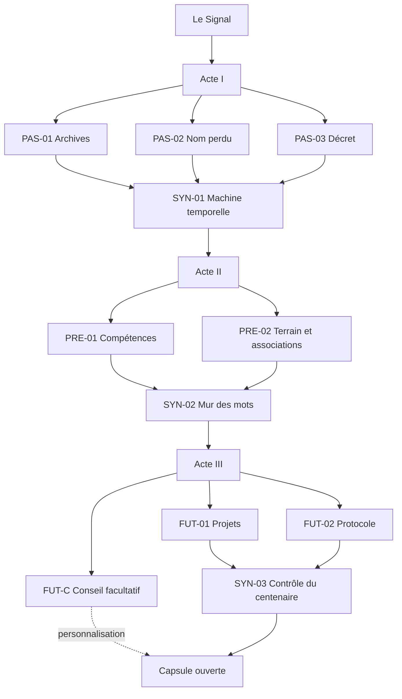
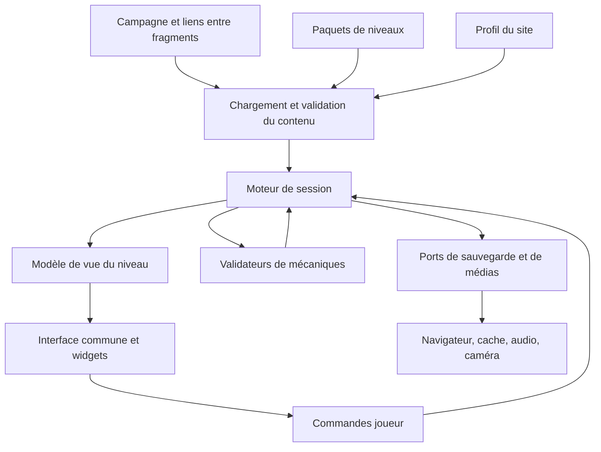

# Chrono-IIE — La mémoire de demain

**Game design complet, direction artistique, dialogues et architecture du projet.**

Version consolidée du 15 octobre 2026 pour le hackathon ENSIIE. Ce document est la référence commune d’une équipe de réalisation de **deux personnes**. Un premier socle exécutable est maintenant disponible ; les sections de conception décrivent le jeu complet visé, au-delà des prototypes déjà réalisés.

Le README réunit « Chrono-IIE » et « La mémoire de demain ». Il contient les consignes joueurs, les supports, les solutions, les indices, les réactions des personnages et les contrats nécessaires pour développer des niveaux séparément. **Tous les spoilers sont présents.** Les fichiers numérotés de `docs/` conservent les propositions antérieures ; `docs/implementation/` décrit le travail actuel.

## Démarrer le développement

```sh
npm ci
npm run dev
```

Node 22 recommandé. Dans ce workspace WSL, exécuter ces commandes dans Ubuntu, depuis `/home/daniel/hackathon`. Ouvrir `http://localhost:5173` ; `npm run check` lance tous les contrôles.

- [Tableau de travail et fiches de chaque étape](docs/implementation/README.md) : 13 niveaux, la capsule finale et 9 chantiers techniques à se répartir.
- [Guide de contribution à deux](CONTRIBUTING.md) : propriété des fichiers, branches et intégration.
- [Contrat d’auteur](src/authoring/README.md) : format des paquets, réponses, fixtures et ajout de briques.
- Atelier isolé : ouvrir `/?level=syn-01`, ou choisir **Atelier des niveaux** dans l’application.

**Livré :** moteur indépendant de React, contrats validés, progression, aide, dialogues détaillés de l’acte I, sauvegarde/export/import, cartes communes accessibles et treize prototypes. Le parcours principal est jouable jusqu’à SYN-03 ; EXT-EST est facultatif. Le profil réel Évry 2026 utilise O1 = 2 et O2 = 3, avec trajets et secours textuel. Les autres paquets sont explicitement `draft`, avec leur conception complète dans `TASK.md`.

**Phase 2 livrée :** Conseil facultatif à trois questions et quatre fins, engagements, frise sourcée, contribution privée locale et export du souvenir. Voir le [guide des fins](game/endings/README.md).

**À poursuivre :** photos et recette terrain, chronomètre et validation hors ligne sur l’hébergement HTTPS. La préparation explicite du cache est intégrée via le chantier 07. Les fiches indiquent précisément les dépendances communes de chaque niveau.

Le [bilan de la phase 1 — contenu et interface](docs/implementation/PHASE-1-TEAMMATE.md) décrit les adaptations du prototype : code postal seul pour EXT-EST, nom d’équipe conservé et directions réelles désormais intégrées. Le [relevé Évry 2026](game/sites/evry-2026/README.md) documente O1 = 2 baby-foot dans le foyer et O2 = 3 salles de TP au premier étage, d’après les informations du porteur du projet. Les photos seront ajoutées plus tard.

Pour jouer sur place, une nouvelle partie utilise **Évry 2026** par défaut ; les profils DEMO restent disponibles dans le sélecteur de nouvelle partie. L’atelier accepte `/?level=pas-02&site=evry-2026`. Les sauvegardes conservent leur profil ; les révisions devenues incompatibles peuvent être exportées avant de recommencer.

## Sommaire

1. [Vision et décisions](#vision)
2. [Univers et personnages](#univers)
3. [Parcours et progression](#parcours)
4. [Direction artistique](#da)
5. [Interface et règles communes](#interface)
6. [Terrain et variantes de site](#terrain)
7. [Prologue intégral](#prologue)
8. [Acte I et dialogues](#acte1)
9. [Acte II et dialogues](#acte2)
10. [Acte III et dialogues](#acte3)
11. [Finale et fins intégrales](#finale)
12. [Dialogues transversaux](#dialogues)
13. [Extension facultative](#extension)
14. [Production artistique et essais](#production)
15. [Sources et décisions documentaires](#sources)
16. [Architecture modulaire sans code](#architecture)

<a id="vision"></a>
## 1. Vision et décisions

### Promesse

**Explorer l’école, contredire une archive défaillante avec des preuves, puis choisir ce que l’on transmet à l’avenir.** Les joueurs reconstruisent une chronologie, déchiffrent un document grâce à une observation physique, réparent une chaîne de traitement, extraient un message et conçoivent un dispositif sous contraintes. Chaque réussite restaure une partie d’ARIIE, l’archive fictive de l’école.

| Paramètre | Décision |
|---|---|
| Joueurs | 3 à 5 par équipe ; jouable à 2 avec échange des rôles |
| Public | Visiteurs, futurs étudiants et étudiants ; aucune connaissance préalable obligatoire |
| Durée complète | Environ 65 à 80 minutes, à mesurer en essai |
| Support | Application web mobile, un appareil principal par équipe |
| Autres appareils | Consultation de sources ou fiches de rôle ; aucune synchronisation automatique dans la première version |
| Réalité physique | Deux observations de repères permanents dans deux zones accessibles distinctes |
| Objets à installer | Aucun objet de résolution ; QR d’accueil facultatif |
| Réseau | Chargement initial nécessaire ; contenus essentiels conservés localement après préparation de l’application |
| Caméra et AR | Extension facultative avec équivalent 2D |
| Défaite | Aucune élimination ; aide complète disponible |
| Réalisation | Moteur commun, interactions réutilisables, dossiers de niveaux autonomes |

Le sujet officiel prévoit une équipe de 3 à 5 réalisateurs ; l’organisation ici suit votre situation de travail à deux. Le nombre de joueurs est un choix de design distinct.

### Arbitrages de fusion

| Idée | Décision |
|---|---|
| ARIIE, capsule et 2068 | Conservées ; le centenaire se rapporte à l’origine de 1968 |
| Trois actes et énigmes de synthèse | Conservés ; chaque synthèse utilise les fragments de son acte |
| Missions indépendantes | Conservées dans chaque acte ; aucun niveau frère ne lit directement un autre niveau |
| Clé IIE et César lié au terrain | Conservés avec texte complet et observation précisément bornée |
| Machine temporelle et Chamarande | Conservées ; une capture consultée remplace la date supposée du 22 décembre |
| Chronologie et décret | Conservés ; donnent des preuves utiles à la machine et au final |
| Atelier des compétences | Enrichi par une réparation de circuit de données |
| Associations | Conservées ; fiches intégrées et observation permanente remplacent les panneaux à installer |
| Mur des mots | Conservé avec mots entiers, grille finie, coordonnées et extraction vérifiée |
| Campus sous contraintes | Conservé ; une solution unique et des chiffres explicitement fictifs |
| Programme coopératif | Renforcé : instructions manquantes, cases interdites et trace à vérifier |
| Conseil du futur et ancienne élève | Conservés ; personnalisation distincte de la réussite |
| Visite imaginaire de 2068 | Répartie entre Nora, les projets et les fins ; les déplacements restent centrés sur deux observations utiles pour maîtriser la durée |
| ARIIE qui se trompe | Conservée dans des scènes écrites, jamais dans les règles ou les directions physiques |
| Erreurs qui rendent les textes illisibles | Écartées ; le glitch reste décoratif |
| Date de création YouTube | Écartée du parcours principal : faible intérêt pédagogique et dépendance externe |
| Cinq sigles de parcours non confirmés | Remplacés par quatre domaines documentés, sans prétention d’exhaustivité |
| Strasbourg comme campus actuel | Corrigé : épisode historique de 2009 à 2017, proposé en extension |
| C-19 devenu un incubateur appelé sIIEnext | Non retenu comme fait établi ; l’entrepreneuriat reste représenté |
| Chiffrement censé empêcher toute triche | Non retenu : des clés courtes et une validation locale ne le garantissent pas |
| Six lettres AVENIR | Remplacées par des fragments sémantiques ; le thème reste dans le titre |

### Critères de réussite

Un joueur doit repartir avec un changement historique, une compétence ou une activité découverte et un arbitrage pour l’avenir. Le parcours doit fonctionner sans règle improvisée. Le déplacement doit servir à une résolution.

Un concepteur doit pouvoir modifier un niveau utilisant les briques existantes sans toucher au moteur, à la sauvegarde, aux autres niveaux ou à la navigation générale.

<a id="univers"></a>
## 2. Univers et personnages

### Situation

En 2068, une capsule doit restituer un siècle de mémoire de l’école. Son programme de conservation, **ARIIE**, a fusionné des fichiers d’époques différentes : des dates désignent les mauvais événements et des projets imaginaires ont été classés comme des faits.

ARIIE contacte une équipe située en **2026**, dans les locaux réels. Les joueurs réparent les origines, le portrait de l’école vivante et les conditions de transmission. **Les joueurs explorent 2026 ; ARIIE parle depuis un 2068 fictif.** Il ne s’agit pas de montrer le véritable futur du campus.

### ARIIE

Nom développé fictif : **ARchive Intelligente de l’IIE**, prononcé « Ari ».

| Aspect | Direction d’écriture |
|---|---|
| Rôle | Guide, archiviste et partenaire d’enquête |
| Personnalité | Curieuse, légèrement ironique, attachée aux preuves, capable de reconnaître une erreur |
| Début | Phrases courtes ; signal fragmenté ; assurance excessive sur certains souvenirs |
| Milieu | Reconnaît l’aide des joueurs et distingue mieux les catégories |
| Fin | Claire et chaleureuse ; demande ce qui mérite d’être transmis |
| Humour | Une remarque ponctuelle après réussite, jamais une moquerie sur une erreur |
| Limite | Aucune fausse direction physique, règle trompeuse ou aide mensongère |

ARIIE est un personnage écrit. **Aucun modèle génératif n’est nécessaire.** Les dialogues utilisent des choix prédéfinis ; les champs libres servent aux réponses et à une contribution finale privée.

### Nora

**Nora**, ancienne élève fictive de la promotion 2045, intervient à l’acte III. Elle entretient des archives pour les générations suivantes. Elle ne représente aucune personne réelle ni aucun projet officiel.

Elle fait passer de la recherche d’une réponse à la construction d’une décision. Son vocabulaire est concret. Elle introduit les projets, le programme coopératif et le Conseil du futur.

### Joueurs

Nom narratif : **équipe de restauration temporelle**. Rôles possibles : archiviste, observateur, opérateur, lecteur, vérificateur. Les rôles changent librement.

Le nom d’équipe est facultatif, limité à 24 caractères ; défaut : « Équipe Chrono ». Aucun compte ni courriel. L’appareil principal conserve le carnet.

<a id="parcours"></a>
## 3. Parcours et progression

### Séquences

| ID | Séquence | Fonction | Cible |
|---|---|---|---:|
| PRO-00 | Le Signal | Tutoriel et contrat de fiction | 4 min |
| PAS-01 | Les archives déclassées | Chronologie et origine institutionnelle | 5 min |
| PAS-02 | Le nom perdu | Observation O1 et chiffrement | 6 min |
| PAS-03 | Le décret aux trois dates | Enquête sur 2006 | 4 min |
| SYN-01 | La machine temporelle | Assemblage et archive de Chamarande | 6 min |
| PRE-01 | L’atelier des compétences | Association et circuit | 6 min |
| PRE-02 | Les yeux d’ARIIE | Observation O2 et vie étudiante | 6 min |
| SYN-02 | Le mur des mots | Recherche et extraction orientée | 6 min |
| FUT-01 | Le campus sous contraintes | Choix de projets | 6 min |
| FUT-02 | Le protocole incomplet | Programmation coopérative | 6 min |
| FUT-C | Le Conseil du futur | Trois choix de valeurs | 3 min |
| SYN-03 | Le contrôle du centenaire | Dialogue avec preuves | 5 min |
| END | La capsule ouverte | Fin personnalisée | 2 min |

Environ 65 minutes d’interaction et de narration, plus 5 à 10 minutes de marche et les pauses. Les missions d’un acte sont disponibles dans n’importe quel ordre ; les durées restent à tester.



### Règles de déblocage

- Actes séquentiels ; missions indépendantes à l’intérieur de chaque acte.
- Une synthèse apparaît dès l’ouverture de l’acte avec ses fragments manquants ; elle exige toutes les missions requises.
- Chaque réussite attribue une seule fois un fragment et une capsule de savoir.
- `2101` et `CAPSULE` sont des résultats narratifs ; les saisir sans les missions accomplies ne saute pas un acte.
- Les missions résolues restent consultables ; leurs récompenses ne peuvent pas être attribuées deux fois.
- Le Conseil est facultatif. Les extensions ne conditionnent jamais la victoire.

### Fragments et usages

| Producteur | Fragment | Usage |
|---|---|---|
| PAS-01 | Origine 1968 ; CNAM ; frise ordonnée | Machine et preuve historique |
| PAS-02 | IIE ; texte restitué | Domaine historique |
| PAS-03 | Transition 01/08/2006 ; décret | Machine et preuve finale |
| SYN-01 | Annonce du 21/01/2005 à Chamarande | Acte II |
| PRE-01 | MODELE, LOGICIEL, INTERFACE, CALCUL | Mur des mots |
| PRE-02 | MUSIQUE, JEUX, ROBOTIQUE, VIRTUEL ; O2 | Mur et sens d’extraction |
| SYN-02 | CAPSULE | Acte III |
| FUT-01 | BCF ; totaux 8, 4, 9 ; statut fictif | Preuve finale |
| FUT-02 | Programme réparé ; trace ; OUVRE | Transmission |

### Intégrité d’ARIIE

L’intégrité va de 0 à 100. Les neuf réussites PAS-01, PAS-02, PAS-03, SYN-01, PRE-01, PRE-02, SYN-02, FUT-01 et FUT-02 donnent chacune 10 points ; SYN-03 donne les 10 derniers. Le total est recalculé depuis les réussites uniques.

Le prologue, les erreurs, le Conseil, les indices et l’extension n’y changent rien. Une mission accompagnée compte aussi. États visuels : 0–39 « signal fragmenté », 40–69 « mémoire en reconstruction », 70–99 « transmission presque stable », 100 « mémoire restaurée ». La corruption est seulement l’inverse visuel de cette intégrité.

<a id="da"></a>
## 4. Direction artistique

### Intention

**Un terminal d’archives qui retrouve progressivement une identité claire.** Le jeu combine carnet documentaire et instrument scientifique. Les documents restent lisibles ; la science-fiction se manifeste dans les cadres, les transitions et l’avatar.

Éviter l’accumulation de néons, les lignes de code décoratives et le terminal vert intégral. Les archives et les repères réels doivent rester au premier plan.

### Palette

| Rôle | Couleur indicative | Emploi |
|---|---|---|
| Fond | `#101820` | Navigation et scènes |
| Panneau | `#1B2733` | Cartes et choix |
| Texte | `#F4F1E8` | Texte principal |
| Secondaire | `#C5CED6` | Métadonnées |
| Passé | `#E7B56A` | Ambre, dossier |
| Présent | `#70D6E7` | Cyan, réseau |
| Avenir | `#BEAFF5` | Lavande, graine |
| Réussite | `#9BD6B0` | Coche et confirmation |
| Erreur | `#FFB3A7` | Message et icône |
| Papier | `#F3EBDD` | Documents avec texte sombre `#20272E` |

Le contraste des combinaisons réellement utilisées devra être mesuré à la réalisation. La couleur ne transmet jamais seule une information.

### Typographie et composition

- Corps sans empattement : police système au prototype ; Inter ou équivalent intégré localement avec licence si nécessaire.
- Codes et coordonnées en monospace système ; IBM Plex Mono est une alternative à intégrer localement.
- Base mobile 18 px, interligne autour de 1,5 ; titres 26–32 px ; métadonnées utiles au moins 14 px.
- Commandes tactiles d’au moins 44 × 44 px, espacées, avec verbes explicites.
- Une colonne pour les documents et une action principale par écran.
- Dialogue et puzzle conservent leur position ; une réplique ne déplace pas les commandes sous le doigt.
- Alternative « sélectionner puis placer » pour chaque glisser-déposer. Aucune information essentielle au survol.

### Identité des actes

| Acte | Matière et motifs | Mouvement | Avatar |
|---|---|---|---|
| Passé | Papier, dossiers, dates, mention « reconstitution » | Ouverture de dossier | Trois arcs disjoints |
| Présent | Plans schématiques, connexions, activités | Connexions validées qui s’allument | Arcs alignés |
| Avenir | Schémas de projets, surfaces aérées | Assemblages et traces | Anneau presque complet |
| Final | Frise et projection choisie | Ouverture en deux secondes maximum | Forme complète puis stable |

Sans relevé du bâtiment, employer une liste de destinations plutôt qu’une carte inventée présentée comme exacte.

### Avatar et animation

ARIIE est un disque formé de trois arcs autour d’un point lumineux. Pas de visage humain ni de modèle 3D nécessaire. Son état est aussi écrit en toutes lettres.

Le glitch est bref et décoratif : décalage de bordure ou fragment de signal avant le texte. Aucun mot utile n’est remplacé aléatoirement ; aucun clignotement ne sert d’indice. Une option réduit ou supprime les animations.

L’effet machine à écrire est facultatif. Toucher une phrase l’affiche immédiatement. Les lecteurs d’écran reçoivent la phrase entière, pas chaque caractère séparément. Les annonces de validation sont discrètes et uniques.

### Audio

Le jeu fonctionne sans son. Quatre sons courts suffisent : connexion, fragment, validation d’acte, capsule finale. Pas d’alarme d’erreur. Musique facultative, très basse, arrêtée pendant la coopération. Les voix enregistrées éventuelles reproduisent les textes et proposent lecture, pause et volume.

### Documents

Trois badges : **fait sourcé**, **reconstitution pédagogique**, **projection fictive 2068**. Les dates de capture restent visibles quand elles jouent un rôle. Une reconstitution ne prétend pas être un fac-similé.

Les photographies ajoutées auront une provenance et des droits vérifiés. Des formes simples suffisent aux pictogrammes. Aucun logo externe ni portrait historique n’est indispensable à la résolution.

<a id="interface"></a>
## 5. Interface et règles communes

### Écrans

| Écran | Contenu | Action |
|---|---|---|
| Accueil | Titre, durée, version, profil réel ou démo, réglages | Commencer / Reprendre |
| Conversation | Avatar, messages, questions, accès au défi | Choisir / Ouvrir |
| Carte d’acte | Missions, synthèse, fragments manquants | Choisir une mission |
| Énigme | Consigne stable, supports, interaction, indices | Vérifier |
| Mémoire | Fragments, preuves, capsules et sources | Relire |
| Résultat | Réaction, savoir et récompense | Retour à l’acte |
| Fin | Frise, texte personnalisé, durée et aides | Relire / Exporter |

Navigation basse : **Mission**, **Conversation**, **Mémoire**, **Réglages**. Les saisies restent présentes lors d’un changement d’onglet.

### Indices et assistance

Trois indices par énigme bloquante, disponibles immédiatement dans l’ordre, sans pénalité en mode découverte. Chaque révélation est volontaire. Après trois essais de fond incorrects, ARIIE propose le premier indice non consulté, sans l’afficher automatiquement. Les erreurs de format ne comptent pas comme essais de fond.

Après le troisième indice, **Résoudre avec ARIIE** affiche la démarche complète et demande de confirmer sa lecture. Le niveau est terminé avec le statut « accompagné » et ses fragments habituels. Le texte de cette aide est exactement la solution suivie de la capsule de savoir du niveau.

Pas de score compétitif, délai artificiel ou blocage de saisie dans cette version. Le bilan indique la durée et les aides. La partie reste jouable après la durée cible.

### Validation

- Codes : espaces extérieurs ignorés, zéros initiaux conservés.
- Dates : format annoncé ; variantes explicitement acceptées ; contrôle du calendrier.
- Mots : normalisation de casse et d’accents selon le niveau. Pas de suppression universelle de ponctuation.
- Ensembles : ordre indifférent seulement si annoncé ; doublons refusés.
- Programmes : instructions et trajet vérifiés, pas seulement le mot final.
- Documents et grilles : annotations, sélections et position conservées à la reprise.

### Coopération et appareils

Un appareil est le carnet officiel. Les autres consultent des sources ou fiches, sans synchronisation automatique. La fiche d’opérateur de FUT-02 peut être ouverte par un lien de rôle ne donnant aucun droit de validation, ou les joueurs peuvent alterner les vues sur le même appareil.

L’indépendance des missions permet de se répartir le travail ; le jeu synchronisé sur plusieurs téléphones reste une extension explicite.

<a id="terrain"></a>
## 6. Terrain et variantes de site

### Observations nécessaires

| ID | Repère recherché | Valeur | Usage |
|---|---|---|---|
| O1 | Inscription ou petit ensemble permanent dans une zone précisément bornée | Entier de 1 à 9 | Décalage César |
| O2 | Autre inscription numérique permanente dans une seconde zone | Entier non négatif | Parité déterminant le sens d’extraction |

Préférer une inscription lisible depuis un espace public. Un comptage de portes n’est recevable qu’avec périmètre et exclusions illustrés. « Toutes les salles de TP » ou « tous les étages accessibles » ne constituent pas des questions assez précises.

Une observation ne prouve pas techniquement la présence ; un coéquipier peut transmettre la réponse. L’exploration repose sur la coopération.

### Profil DEMO

**Relevé réel Évry 2026 reçu le 15 octobre 2026 :** O1 = **2**, baby-foot du foyer (tourner à droite en entrant) ; O2 = **3**, salles de TP du premier étage (rejoindre le premier étage depuis l’entrée). Les deux zones sont déclarées toujours accessibles par le porteur du projet. Le profil réel doit donc utiliser un César +2 et la grille impaire. Les consignes et secours textuels sont prêts dans la [fiche de site](game/sites/evry-2026/README.md) ; profil activé dans le jeu, photos à ajouter plus tard.

Pour tester sans inventer le bâtiment, deux cartes fictives sont fournies : **Repère d’archive : 3** et **Repère de lecture : 4**. Donc O1 = 3 et O2 = 4, pair. Chaque carte affiche **simulation de terrain — valeurs fictives**.

Les solutions et grilles de ce README sont entièrement déterminées pour DEMO. Ces valeurs ne décrivent aucun lieu réel de l’ENSIIE.

### Profil réel

Chaque relevé comprend : question exacte, nom du lieu, directions depuis un repère connu, photographie de contrôle, texte alternatif, réponse, normalisation, accès, date et auteur de vérification, solution de secours.

Un profil réel incomplet bloque sa publication, pas le développement des niveaux. Le décalage et la grille utilisent un profil commun ; personne ne recopie les valeurs dans plusieurs fichiers.

### Trajet

P0 départ → O1 pendant l’acte I → O2 pendant l’acte II → retour P0 pour l’acte III. Les missions documentaires se jouent dans des espaces où l’équipe peut s’arrêter.

Les lieux exacts restent à repérer. Le sujet mentionne C33 au sIIEnext, sans permettre de déduire un plan intérieur, des distances ou des portes accessibles. Le parcours réel exige les deux observations distinctes validées.

Si une zone est fermée, **Ce repère est inaccessible** ouvre la photo de contrôle ou le relevé de secours vérifié, avec la mention « observation assistée ». Aucun fragment n’est retiré.

<a id="prologue"></a>
## 7. Prologue intégral

### PRO-00 — Le Signal

**But :** lire un indice, saisir une réponse, comprendre la fiction. Réponse : `ENSIIE`.

Les identifiants de réplique servent à l’écriture, pas à l’interface. Une question secondaire revient au choix indiqué ; les textes entre guillemets sont prêts à intégrer.

| ID | Voix ou choix | Texte et suite |
|---|---|---|
| PRO.01 | ARIIE | « Signal reçu. Année de votre terminal : 2026. Année de mon archive : 2068. Ce décalage est… plus important que prévu. » |
| PRO.02 | ARIIE | « Je suis ARIIE, l’Archive Intelligente de l’IIE. Je dois ouvrir une capsule de mémoire. Mais mes souvenirs ont mélangé les époques. » |
| PRO.Q | Choix | « Qui t’a créée ? » → PRO.A1 ; « Pourquoi nous ? » → PRO.A2 ; « Comment t’aider ? » → PRO.03 |
| PRO.A1 | ARIIE | « Dans cette histoire, je conserve la mémoire de l’école. Mon existence et la capsule sont fictives ; les documents historiques sont sourcés. » Retour PRO.Q. |
| PRO.A2 | ARIIE | « Vous êtes dans les locaux que je ne peux plus observer. Vous pouvez vérifier ce que je raconte. C’est exactement la compétence qui me manque. » Retour PRO.Q. |
| PRO.03 | ARIIE | « Choisissez un nom d’équipe, ou gardez Équipe Chrono. » |
| PRO.04 | ARIIE | « Merci, {equipe}. Je peux me tromper dans mes souvenirs. Mes consignes et mes indices resteront fiables. Si une affirmation vous paraît douteuse, cherchez une preuve. » |
| PRO.05 | ARIIE | « Pour rétablir le canal, recopiez les six lettres encadrées ci-dessous. Elles restent visibles : aucune vitesse particulière n’est nécessaire. » |

**Support :** `[E]nquête [N]umérique — [S]ouvenirs [I]ncomplets, [I]dentité [E]ffacée.` Les crochets deviennent des cadres fixes.

**Consigne :** « Lisez les lettres encadrées de gauche à droite et saisissez le nom obtenu. »

| Situation | Réplique |
|---|---|
| Erreur | « Regardez seulement les lettres encadrées. Leur ordre est celui de la lecture. » |
| Indice 1 | « Les autres lettres servent à former la phrase. » |
| Indice 2 | « Le résultat commence par E, N, S. » |
| Indice 3 | « Ajoutez I, I, E : vous avez les six lettres. » |
| PRO.OK | « ENSIIE. Canal restauré. Le nom complet est École nationale supérieure d’informatique pour l’industrie et l’entreprise. » |
| PRO.NEXT | « Nous allons commencer avant ce nom. Trois dossiers vous attendent. Choisissez leur ordre ; nous aurons besoin des trois pour redémarrer ma machine temporelle. » |

**Capsule K-PRO :** « Le nom ENSIIE reprend les lettres IIE de l’ancien nom. Le parcours va relier ces deux identités. » Sources S04, S08. Action : **Ouvrir le passé**.

<a id="acte1"></a>
## 8. Acte I et ses dialogues

### Entrée de l’acte

**A1.ENTER — ARIIE :** « J’ai retrouvé trois dossiers : une chronologie, un nom chiffré et un changement de statut. Vous pouvez commencer par celui que vous voulez. Les documents sont accessibles dans chaque dossier ; vous n’avez pas besoin de connaître les réponses à l’avance. »

**A1.WAIT — synthèse verrouillée :** « La machine attend les trois dossiers restaurés. Les emplacements vides indiquent ce qui lui manque. » Le nom des dossiers manquants est affiché, sans faux bouton actif.

### PAS-01 — Les archives déclassées

**Type :** classement documentaire. **Accès :** acte I ouvert. **Source :** S04, S05, S15. **Difficulté :** facile, montée en confiance.

#### Ce que voit le joueur

Un bureau d’archives avec quatre cartes sans date, dans cet ordre initial : **Évry**, **nouveau nom**, **anciens élèves**, **création**. Quatre notices s’ouvrent séparément ; elles peuvent être réparties entre les joueurs.

| Carte | Texte affiché |
|---|---|
| Création | « L’institut est créé au sein de sa maison mère. » |
| Anciens élèves | « Les ingénieurs issus de l’institut constituent leur association. » |
| Évry | « L’école quitte ses locaux parisiens pour s’installer à Évry. » |
| Nouveau nom | « L’IIE devient l’ENSIIE. » |

**Notice Origines :** « En 1968, l’Institut d’informatique d’entreprise est créé au Conservatoire national des arts et métiers, le Cnam. »

**Notice Communauté :** « Les ingénieurs IIE se regroupent dans leur association, l’A3IE, à partir de 1973. »

**Notice Lieux :** « Après ses locaux du Cnam à Paris, rue Saint-Martin, l’école s’installe à Évry en 1984. »

**Notice Identité :** « L’année 2006 marque le passage à l’ENSIIE. La date précise d’entrée en vigueur appartient à un autre dossier. »

Mention commune : **reformulations pédagogiques de sources institutionnelles**. Les notices restent disponibles pendant le classement.

#### Consigne

« Associez chaque événement à son année, rangez les quatre cartes du plus ancien au plus récent, puis identifiez la maison mère de l’institut. Justifiez l’origine en sélectionnant la notice qui la documente. »

Interactions : sélectionner une carte puis une position, ou la déplacer ; quatre champs d’année ; choix de maison mère parmi CNAM, une autre institution fictivement proposée comme leurre et « je ne sais pas encore » ; sélection d’une notice comme preuve. Le leurre affiché est **Université de Strasbourg**, qui intervient dans un autre épisode historique mais pas dans cette origine.

#### Solution et validation

Ordre : **création 1968 → anciens élèves 1973 → Évry 1984 → nouveau nom 2006**. Maison mère : **CNAM**. Preuve de l’origine : **Notice Origines**. Les trois éléments sont validés ensemble ; un message précise si c’est l’ordre, une date ou la preuve qui manque.

Le niveau ne dépend pas du déchiffrement de PAS-02. Les acronymes peuvent déjà être connus ; l’enjeu est de restaurer le document, pas de cacher chaque fait jusqu’à sa découverte.

#### Dialogues complets du niveau

| ID | Déclencheur | Texte |
|---|---|---|
| P1.ENTER | Ouverture | « Ma première date certaine est 1972. Donc l’école est née en 1972. Raisonnement impeccable… sauf si j’ai confondu deux événements. » |
| P1.Q | Choix | « Vérifions les notices. » → puzzle ; « Que représente 1972 ? » → P1.A ; « Comment classer ? » → P1.M |
| P1.A | Question | « Une trace parle de reconnaissance du diplôme. Cela ne prouve pas la date de naissance de l’institut. Cherchez la notice consacrée à l’origine. » Puis puzzle. |
| P1.M | Méthode | « Associez d’abord chaque carte à sa notice. Rangez ensuite les événements. Les dates sont des indices, pas des numéros de dossier. » Puis puzzle. |
| P1.ERROR | Erreur générale | « Au moins une association ne correspond pas à la notice. Vérifiez l’événement avant de modifier toute la frise. » |
| P1.NEAR | Origine 1972 | « 1972 correspond ici à la reconnaissance du diplôme. La création de l’institut est antérieure. » |
| P1.PROOF | Preuve incorrecte | « Cette notice parle d’un autre événement. Choisissez celle qui nomme la maison mère au moment de la création. » |
| P1.H1 | Indice 1 | « Chaque notice contient le sujet d’une des cartes. » |
| P1.H2 | Indice 2 | « La communauté des anciens précède l’arrivée à Évry ; le changement de nom arrive en dernier. » |
| P1.H3 | Indice 3 | « L’ordre des années est 1968, 1973, 1984, 2006. La première notice nomme le Cnam. » |
| P1.OK | Réussite | « Vous aviez raison de vérifier. J’avais pris une reconnaissance pour une naissance. Origine retrouvée : 1968, au Cnam. » |
| P1.EXIT | Après capsule | « Je garde cette frise dans notre mémoire commune. Vous pourrez la consulter à tout moment. » |

**K-P1 — capsule :** « L’école commence comme IIE au Cnam. Son implantation, son nom et sa communauté évoluent ensuite. La date d’un diplôme ne se confond pas avec celle de la création. »

**Récompense :** origine 1968, maison mère CNAM et frise comme preuve consultable. **Reprise :** toutes les positions et années sont conservées. **Assistance :** montrer l’ordre corrigé et les passages utiles des notices.

### PAS-02 — Le nom perdu

**Type :** terrain et César. **Accès :** acte I ouvert, indépendamment de PAS-01. **Source historique :** S05, S08. Le chiffrement est une invention du jeu.

#### Support et terrain

ARIIE donne la destination O1 du profil de site, avec question et photo de repérage. La réponse est un entier de 1 à 9. Le profil DEMO affiche seulement une carte fictive portant **3**.

Une note de méthode explique : « Pour stocker ce document, chaque lettre a été avancée de O1 positions dans l’alphabet A à Z. Z revient à A. Les espaces sont conservés. Pour lire le document, il faut revenir en arrière du même nombre de positions. »

Une roue alphabétique ou deux lignes d’alphabet permettent de manipuler le décalage. En DEMO, le texte chiffré exact est :

**LQVWLWXW LQIRUPDWLTXH HQWUHSULVH**

Le texte contient les trois mots importants du nom, sans articles ni prépositions. Il ne prétend pas être la transcription d’une lettre historique.

#### Consigne

« Relevez la valeur du repère indiqué. Réglez le décalage de lecture, déchiffrez les trois mots, puis formez le sigle avec leurs initiales. Validez le repère, le texte et le sigle. »

#### Solution

DEMO : O1 = **3**, déchiffrement par recul de trois lettres. Résultat : **INSTITUT INFORMATIQUE ENTREPRISE** ; initiales **IIE**. Le nom développé est ensuite présenté correctement : Institut d’informatique d’entreprise.

La validation demande le bon relevé, le décalage appliqué dans le bon sens et le sigle. Deviner IIE ne suffit pas à restaurer le texte. Pour un profil réel, le texte chiffré est préparé à partir du même texte clair et de son O1 vérifié ; il n’est pas conservé arbitrairement à +3.

#### Dialogues

| ID | Déclencheur | Texte |
|---|---|---|
| P2.ENTER | Ouverture | « Trois mots se sont décalés dans mon alphabet. La clé de lecture a été associée à un repère que vous pouvez encore observer. » |
| P2.GO | Terrain réel | « Rendez-vous dans {O1.lieu}. {O1.direction} Relevez ceci : {O1.question} Vous pouvez revenir à la mission sans perdre votre progression. » |
| P2.DEMO | Terrain simulé | « Nous sommes en démonstration : la carte fictive remplace l’observation. Elle ne décrit pas les locaux réels. » |
| P2.Q | Choix | « Explique le chiffrement. » → P2.A ; « Nous allons observer. » → terrain |
| P2.A | Explication | « Une lettre avance toujours du même nombre de positions. Pour déchiffrer, faites le trajet inverse. Les espaces ne changent pas. » Puis puzzle. |
| P2.OBSERROR | Relevé incorrect | « Ce relevé ne correspond pas au repère enregistré. Vérifiez le périmètre ou utilisez la photo de secours si le lieu est inaccessible. » |
| P2.ERROR | Déchiffrement incorrect | « Le sigle seul ne répare pas la page. Vérifiez le sens de rotation et les trois mots obtenus. » |
| P2.H1 | Indice 1 | « La valeur observée sert à déplacer l’alphabet, pas à compter les mots. » |
| P2.H2 | Indice 2 | « Le stockage a avancé les lettres. La lecture doit les faire reculer. » |
| P2.H3 | Indice 3 | « Avec le décalage observé, le premier mot devient INSTITUT. Les deux autres sont INFORMATIQUE et ENTREPRISE. Prenez les initiales. » |
| P2.OK | Réussite | « IIE. Mon ancien nom tient dans trois lettres, mais vous avez restauré les mots qui leur donnent un sens. » |
| P2.EXIT | Après capsule | « Je conserve le sigle et la page déchiffrée. Ma machine saura maintenant quelle archive chercher. » |

**K-P2 :** « L’ancienne école portait le nom d’Institut d’informatique d’entreprise. Le sigle IIE a été conservé dans ENSIIE. » **Récompense :** fragment IIE et texte restitué. **Reprise :** relevé et réglage conservés. **Secours terrain :** photo ou valeur vérifiée, jamais une valeur improvisée.

### PAS-03 — Le décret aux trois dates

**Type :** enquête documentaire. **Accès :** acte I ouvert. **Sources :** S06, S07, S08.

#### Trois pièces affichées

1. **Texte :** « Décret n° 2006-805, daté du 5 juillet 2006, portant création de l’ENSIIE. »
2. **Publication :** « Ce décret figure dans le Journal officiel du 7 juillet 2006. »
3. **Règle :** « Son article 4 fait commencer l’application le premier jour du mois suivant la publication. »

Ce sont des reformulations pédagogiques avec liens vers les textes, pas des documents inventés présentés comme authentiques.

**Consigne :** « Retrouvez la date d’entrée en vigueur. Saisissez le jour, le mois et l’année. Expliquez votre choix en sélectionnant les deux pièces nécessaires au calcul. »

**Solution :** publication en juillet → premier jour d’août → **01/08/2006**. Pièces utiles : **Publication + Règle**. Accepter `01082006`, `01/08/2006`, `1/8/2006` et `2006-08-01` comme représentations d’une même date. La représentation interne reste une date, pas un entier.

| ID | Déclencheur | Texte |
|---|---|---|
| P3.ENTER | Ouverture | « J’ai trois dates possibles pour un changement. Avant de supprimer des doublons, je préfère vérifier si elles parlent vraiment de la même chose. » |
| P3.Q | Choix | « Pourquoi changer de nom ? » → P3.A ; « Examinons les pièces. » → puzzle |
| P3.A | Question | « La FAQ de l’époque relie le nouveau nom à un nouveau statut et à davantage d’autonomie. Ici, nous cherchons quand le texte commence à s’appliquer. » Puis puzzle. |
| P3.DATE | Mauvais format | « Il me faut une date complète. Vous pouvez écrire jour/mois/année. » |
| P3.NEAR1 | 05/07/2006 | « C’est la date du décret. Cherchez le début de son application. » |
| P3.NEAR2 | 07/07/2006 | « C’est la publication. Il reste à appliquer la règle de calendrier. » |
| P3.ERROR | Autre erreur | « Vérifiez le mois de publication et le premier jour du mois suivant. » |
| P3.PROOF | Date juste, mauvaise preuve | « La date convient. Montrez maintenant les pièces qui permettent de la déduire. » |
| P3.H1 | Indice 1 | « Une pièce fournit une date, une autre fournit une règle. » |
| P3.H2 | Indice 2 | « La règle part du Journal officiel, pas du titre du décret. » |
| P3.H3 | Indice 3 | « Le mois qui suit juillet est août. Prenez son premier jour en 2006. » |
| P3.OK | Réussite | « Trois dates, trois rôles. Transition restaurée : le 1er août 2006. » |
| P3.EXIT | Après capsule | « Cette preuve restera accessible au contrôle final. » |

**K-P3 :** « Le décret est daté du 5 juillet 2006, publié le 7 juillet et applicable le 1er août. Le passage à l’ENSIIE est une évolution institutionnelle, pas seulement une nouvelle enseigne. » **Récompense :** date de transition et référence du décret.

### SYN-01 — La machine temporelle

**Type :** assemblage de fragments puis lecture d’archive. **Prérequis :** trois missions du passé réussies ou accompagnées. **Sources :** S03, S05, S16.

#### Écran et paramètres

La machine affiche quatre zones : **Origine**, **Adresse historique**, **Capture recherchée**, **Transition**. Les fragments apparaissent dans un tiroir toujours visible.

| Zone | Action et valeur correcte |
|---|---|
| Origine | Déposer le fragment 1968 |
| Adresse historique | Assembler IIE + CNAM avec le gabarit « nom.hôte.fr » : `iie.cnam.fr` |
| Capture recherchée | Convertir la date affichée sur la fiche « capture du 17/12/2004 » en `20041217` |
| Transition | Déposer la date 01/08/2006 |

Les sous-domaines historiques ne sont pas devinés par le joueur. La machine utilise une correspondance éditoriale vers la capture précise de S16 : `20041217012944` pour la page Événements de l’ancien site `www3.iie.cnam.fr`. Le cadran jour ne prétend pas déterminer à lui seul toute l’URL.

**Consigne 1 :** « Placez les fragments dans les quatre zones. Pour la capture, écrivez année, mois et jour : AAAAMMJJ. »

Une fois la machine calibrée, elle ouvre une **reconstitution locale lisible** de la page Événements. Un bouton séparé donne accès à la vraie archive si le réseau fonctionne. Le jeu ne dépend pas de son chargement.

#### Contenu intégral nécessaire de l’archive locale

**En-tête :** « Site de l’IIE — Événements. Capture conservée le 17 décembre 2004. »

**Annonce reformulée :** « La remise des diplômes de la promotion 2004 est annoncée pour le 21 janvier 2005 au château de Chamarande. »

**Note :** « La date de capture décrit la conservation de la page. La date de promotion désigne le groupe diplômé. La date de l’annonce désigne le rendez-vous prévu. » Cette note se trouve dans l’aide documentaire, visible sur demande ; le titre et l’annonce suffisent à résoudre.

**Consigne 2 :** « Retrouvez le jour et le mois du rendez-vous annoncé pour la promotion 2004. Saisissez-les au format JJMM et sélectionnez le lieu. » Choix de lieu : **Château de Chamarande**, **Paris**, **Évry**.

#### Solution

Clé **2101**, lieu **Château de Chamarande**, année du rendez-vous **2005**. L’année n’est pas saisie dans le cadenas JJMM mais apparaît dans le débrief. Le résultat prouve ce que la page annonçait, pas à lui seul que la cérémonie a eu lieu.

| ID | Déclencheur | Texte |
|---|---|---|
| S1.ENTER | Ouverture | « Nous avons une origine, un nom et une transition. Placez-les dans la machine. J’ai gardé l’étiquette de la capture ; elle nous permettra de retrouver une page précise. » |
| S1.SLOT | Assemblage erroné | « Au moins un fragment est dans la mauvaise zone. Une année d’origine n’est pas une date de capture. » |
| S1.DATE | Capture mal formatée | « Pour cette zone, la machine lit année, mois, jour. Le 17 décembre 2004 doit garder les quatre chiffres de l’année. » |
| S1.OPEN | Calibration réussie | « Destination retrouvée. Voici ce que le site annonçait à cette date. Cherchez le rendez-vous de la promotion 2004. » |
| S1.NEAR1 | 1712 | « Vous avez choisi la date de capture. Je cherche le rendez-vous annoncé dans la page. » |
| S1.NEAR2 | 2005 | « L’année convient au rendez-vous, mais le cadenas attend son jour et son mois. » |
| S1.ERROR | Autre erreur | « Relisez l’annonce : la promotion, la capture et le rendez-vous n’ont pas le même rôle. » |
| S1.H1 | Indice 1 | « Associez les étiquettes de la machine aux fragments, puis ouvrez la rubrique Événements. » |
| S1.H2 | Indice 2 | « La capture est en décembre 2004 ; le rendez-vous annoncé se déroule en janvier de l’année suivante. » |
| S1.H3 | Indice 3 | « L’annonce donne le 21 janvier 2005 au château de Chamarande. Le cadenas attend seulement JJMM. » |
| S1.OK | Réussite | « 2101. Le rendez-vous est retrouvé. Une archive peut conserver une annonce de demain au milieu des traces d’hier. » |
| S1.EXIT | Fin d’acte | « Le passé tient de nouveau debout. Regardons maintenant ce que l’école permet d’apprendre et de faire ensemble. » |

**K-S1 :** « Une capture de décembre 2004 conserve une annonce pour janvier 2005 concernant la promotion 2004. Lire une archive suppose de distinguer ces dates. » **Récompense :** clé 2101 et ouverture de l’acte II. Les saisies de calibration persistent si la lecture de la source externe interrompt la partie.

<a id="acte2"></a>
## 9. Acte II et ses dialogues

**A2.ENTER — ARIIE :** « J’ai retrouvé les dates. Il me manque maintenant la vie entre les dates : les compétences, les projets et les activités. Deux missions peuvent avancer séparément. »

### PRE-01 — L’atelier des compétences

**Type :** association de domaines et circuit de données. **Source :** S09. **But :** manipuler les liens entre compétences au lieu de seulement réciter des intitulés.

#### Situation et supports

Un simulateur pédagogique fictif doit transformer un besoin en démonstration fluide. Quatre modules sont mélangés. Chaque module a une mission, un type de donnée d’entrée et un type de sortie. Les types sont visibles, ils ne nécessitent pas de connaître la programmation.

| Module | Mission | Entrée | Sortie |
|---|---|---|---|
| Modéliser | Répartir des ressources sous contraintes | BESOIN | MODELE |
| Vérifier | Contrôler les propriétés du modèle programmé | MODELE | MODELE VALIDE |
| Faire interagir | Concevoir les commandes et les retours du simulateur | MODELE VALIDE | SCENE |
| Accélérer | Répartir les traitements pour fluidifier la simulation | SCENE | DEMO FLUIDE |

Les quatre fiches de domaines sont fournies avec leur définition : **mathématiques appliquées** pour modélisation et optimisation ; **ingénierie logicielle** pour conception et vérification de programmes ; **interactions numériques** pour interfaces et expériences interactives ; **calcul intensif et données massives** pour calcul parallèle et grands ensembles de données.

L’ordre de ce circuit est une règle de cette simulation, **pas une description imposée des cursus ou de tous les projets réels**.

#### Consigne

« Attribuez un domaine principal à chaque module. Branchez ensuite les modules pour transformer BESOIN en DEMO FLUIDE. Une sortie peut être raccordée uniquement à une entrée portant exactement le même nom. Utilisez chaque module une fois. »

#### Solution

Mathématiques → Modéliser ; Ingénierie logicielle → Vérifier ; Interactions numériques → Faire interagir ; Calcul intensif → Accélérer.

Chaîne unique : **BESOIN → Modéliser → Vérifier → Faire interagir → Accélérer → DEMO FLUIDE**. Le prototype montre une impulsion traversant les quatre connexions seulement lorsque le circuit est cohérent. Les domaines doivent également être correctement attribués.

La réussite donne quatre étiquettes de mémoire : **MODELE, LOGICIEL, INTERFACE, CALCUL**. Ce sont des mots de jeu associés aux quatre domaines, pas les sigles officiels de quatre parcours.

| ID | Déclencheur | Texte |
|---|---|---|
| R1.ENTER | Ouverture | « Mon simulateur possède tous ses modules. Il essaie simplement de faire interagir un besoin avant d’avoir construit son modèle. Cela explique plusieurs choses. » |
| R1.Q | Choix | « Faut-il connaître les cursus ? » → R1.A ; « Ouvrons l’atelier. » → puzzle |
| R1.A | Question | « Non. Les fiches expliquent les compétences. Vous cherchez une association principale ; dans un projet réel, les domaines se croisent. » Puis puzzle. |
| R1.DOMAIN | Mauvaise attribution | « Relisez l’action principale du module et la définition du domaine. Les connexions ne suffisent pas à elles seules. » |
| R1.LINK | Raccord incompatible | « Ces deux prises ne portent pas le même type de donnée. La sortie précédente doit correspondre à l’entrée suivante. » |
| R1.ERROR | Circuit incomplet | « Il manque un module ou une liaison pour atteindre DEMO FLUIDE. » |
| R1.H1 | Indice 1 | « Cherchez d’abord le seul module qui accepte BESOIN. » |
| R1.H2 | Indice 2 | « MODELE doit être validé avant de devenir une SCENE dans ce circuit. » |
| R1.H3 | Indice 3 | « L’ordre est Modéliser, Vérifier, Faire interagir, Accélérer. Associez mathématiques, logiciel, interactions et calcul à ces quatre actions. » |
| R1.OK | Réussite | « Le simulateur fonctionne. Vous avez relié des compétences et des informations, pas seulement quatre boîtes. » |
| R1.EXIT | Après capsule | « Je garde quatre mots : MODELE, LOGICIEL, INTERFACE, CALCUL. Ils seront utiles au mur de mémoire. » |

**K-R1 :** « L’école présente notamment des domaines de mathématiques appliquées, de logiciel, d’interactions numériques et de calcul intensif. Cette sélection illustre leur complémentarité sans résumer toute l’offre de formation. »

**Reprise :** associations et connexions conservées. **Alternative tactile :** choisir une sortie, puis une entrée ; aucune obligation de tracer une ligne au doigt.

### PRE-02 — Les yeux d’ARIIE

**Type :** observation O2 et association d’activités. **Source :** S12. Deux sous-objectifs internes, réalisables dans n’importe quel ordre. Le niveau n’attend aucun résultat de PRE-01.

#### Sous-objectif terrain

Se rendre au repère O2 du profil réel. Lire l’inscription demandée. En DEMO, la carte fictive donne **4**. La mission valide la valeur, puis demande : **ce nombre est-il pair ou impair ?** Une note explique qu’un nombre pair est divisible par deux sans reste.

Une petite fiche de protocole annonce déjà l’usage : « Pair : lecture normale, du haut vers le bas et de gauche à droite. Impair : lecture inverse, du bas vers le haut et de droite à gauche. »

#### Sous-objectif vie étudiante

Quatre présentations reformulées d’après la liste institutionnelle sont accessibles dans l’application : Muzzik’ — musique ; LudIIE — jeux de société ; ORiGiNe — robotique ; RealitIIE — réalité virtuelle. Leur activité et leur présence dans les locaux en 2026 seront vérifiées avant toute visite spécifique de leurs espaces. Le niveau n’exige pas d’entrer chez une association.

Les joueurs reçoivent quatre invitations fictives :

| Invitation | Besoin |
|---|---|
| Une répétition | « Nous cherchons des personnes pour jouer d’un instrument ensemble. » |
| Une soirée autour d’un plateau | « Nous voulons découvrir des règles et jouer autour d’une table. » |
| Un atelier de machine mobile | « Nous voulons construire et faire agir un robot. » |
| Une exploration immersive | « Nous voulons créer ou explorer un environnement virtuel. » |

**Consigne :** « Retrouvez le repère indiqué et déterminez sa parité. Associez ensuite chaque invitation à l’activité et au collectif présentés dans les fiches. Les quatre bonnes associations restaureront quatre mots de mémoire. »

#### Solution

DEMO : **4, pair, lecture normale**. Invitations : **Muzzik’**, **LudIIE**, **ORiGiNe**, **RealitIIE** dans l’ordre du tableau. Mots obtenus : **MUSIQUE, JEUX, ROBOTIQUE, VIRTUEL**.

| ID | Déclencheur | Texte |
|---|---|---|
| R2.ENTER | Ouverture | « Mes capteurs ne voient plus les lieux. Soyez mes yeux au repère indiqué. Pendant ce temps, les autres peuvent rendre leurs destinataires à ces invitations. » |
| R2.GO | Terrain réel | « Destination : {O2.lieu}. {O2.direction} Relevez : {O2.question} » |
| R2.DEMO | Démonstration | « La carte de simulation remplace le repère. Son nombre est fictif. » |
| R2.Q | Choix | « Pourquoi ce nombre ? » → R2.A ; « Que sont ces collectifs ? » → R2.B ; « Commençons. » → puzzle |
| R2.A | Question | « Sa parité indique le sens de lecture de mon mur de mémoire. L’observation vous servira après cette mission. » Puis puzzle. |
| R2.B | Question | « Les fiches présentent quatre exemples de vie associative. Elles ne constituent pas la liste complète des activités de l’école. » Puis puzzle. |
| R2.OBSERROR | Relevé incorrect | « Vérifiez le repère exact, pas une inscription voisine. La photo de secours est disponible si le lieu est fermé. » |
| R2.PARITY | Parité incorrecte | « Un nombre pair peut se partager en deux parts entières égales. Vérifiez votre choix. » |
| R2.ERROR | Association incorrecte | « Cherchez l’activité décrite dans chaque invitation. Le nom de l’association peut être moins explicite que sa fiche. » |
| R2.H1 | Indice 1 | « Traitez le relevé et les invitations comme deux petits dossiers séparés. » |
| R2.H2 | Indice 2 | « Muzzik’ correspond à la musique et LudIIE aux jeux de société. » |
| R2.H3 | Indice 3 | « Associez ORiGiNe au robot et RealitIIE au monde virtuel. Conservez ensuite le nombre observé et sa parité. » |
| R2.OK | Réussite | « Observation retrouvée, invitations distribuées. Une école se découvre aussi dans ce que ses élèves choisissent de faire ensemble. » |
| R2.EXIT | Après capsule | « J’ajoute les quatre mots et la règle de lecture à notre mémoire. » |

**K-R2 :** « Musique, jeux, robotique et réalité virtuelle illustrent la diversité des activités étudiantes présentées par l’école. » **Récompense :** quatre mots, valeur O2 et sens de lecture. Si l’un des deux sous-objectifs est réussi, il reste acquis pendant l’autre.

### SYN-02 — Le mur des mots

**Type :** mots cachés et extraction. **Prérequis :** PRE-01 et PRE-02. **Difficulté :** moyenne. Toute la grille est un accessoire original du jeu.

#### Consigne intégrale

« Retrouvez les huit mots de vos fragments. Ils sont écrits horizontalement ou verticalement, dans un sens ou dans l’autre. Sélectionnez leur première et leur dernière case. Les cases marquées d’un point ne contiennent rien et ne sont pas sélectionnables.

Une fois les huit mots retirés, il reste sept lettres. Si le repère O2 est pair, lisez du haut vers le bas et de gauche à droite. S’il est impair, lisez du bas vers le haut et de droite à gauche. Saisissez le message. »

Les huit mots sont affichés depuis le carnet : **MODELE, LOGICIEL, INTERFACE, CALCUL, MUSIQUE, ROBOTIQUE, JEUX, VIRTUEL**. Le jeu n’utilise pas les sigles de deux lettres ambigus de la proposition initiale.

#### Grille complète DEMO

Lignes 1 à 9 de haut en bas ; colonnes 1 à 10 de gauche à droite. Un point représente une case inactive.

| L / C | 1 | 2 | 3 | 4 | 5 | 6 | 7 | 8 | 9 | 10 |
|---|---|---|---|---|---|---|---|---|---|---|
| 1 | · | L | L | O | G | I | C | I | E | L |
| 2 | · | U | · | · | C | · | · | · | · | A |
| 3 | · | C | · | E | U | Q | I | S | U | M |
| 4 | · | L | P | · | · | J | E | U | X | S |
| 5 | · | A | · | E | L | E | D | O | M | · |
| 6 | · | C | · | U | · | · | · | · | · | · |
| 7 | R | O | B | O | T | I | Q | U | E | L |
| 8 | V | I | R | T | U | E | L | E | · | · |
| 9 | · | I | N | T | E | R | F | A | C | E |

#### Corrigé vérifiable

| Mot | Départ (ligne, colonne) | Fin | Sens |
|---|---|---|---|
| MODELE | (5, 9) | (5, 4) | Vers la gauche |
| LOGICIEL | (1, 3) | (1, 10) | Vers la droite |
| INTERFACE | (9, 2) | (9, 10) | Vers la droite |
| CALCUL | (6, 2) | (1, 2) | Vers le haut |
| MUSIQUE | (3, 10) | (3, 4) | Vers la gauche |
| ROBOTIQUE | (7, 1) | (7, 9) | Vers la droite |
| JEUX | (4, 6) | (4, 9) | Vers la droite |
| VIRTUEL | (8, 1) | (8, 7) | Vers la droite |

Les mots ne se chevauchent pas. Les lettres restantes, dans l’ordre normal, sont : **C(2,5), A(2,10), P(4,3), S(4,10), U(6,4), L(7,10), E(8,8)**. O2 = 4 étant pair, le résultat est **CAPSULE**.

Si un profil réel utilise un O2 impair, on conserve les mots et on place **E, L, U, S, P, A, C** dans ces sept positions normales. La lecture inverse produit encore CAPSULE. Cette variante doit être validée à la préparation du profil ; elle ne change pas aléatoirement pendant la partie.

L’interface accepte la sélection d’un mot dans les deux orientations, mais pas un segment partiel, un mot absent du carnet ou une diagonale. Il faut les huit sélections et l’extraction correcte pour réussir.

#### Dialogues

| ID | Déclencheur | Texte |
|---|---|---|
| S2.ENTER | Ouverture | « Vos mots sont revenus, mais ils recouvrent le message qui ouvre la capsule. Retirez seulement les huit mots du carnet, puis utilisez le repère de lecture. » |
| S2.SELECT | Sélection invalide | « Ce segment ne correspond pas à un mot complet du carnet. Les diagonales ne sont pas utilisées. » |
| S2.MISSING | Mot final tenté trop tôt | « Le message ne sera vérifiable qu’après les huit mots. Il en reste à retrouver dans la grille. » |
| S2.NEAR | ELUSPAC dans DEMO | « Les lettres sont les bonnes, mais leur ordre est inversé. Le repère pair impose la lecture normale. » |
| S2.ERROR | Mauvaise extraction | « Reprenez les lettres non barrées, en ignorant les cases vides. Vérifiez le sens indiqué par O2. » |
| S2.H1 | Indice 1 | « La liste de mots vient des deux missions, pas d’un dictionnaire à deviner. » |
| S2.H2 | Indice 2 | « CALCUL est vertical dans la deuxième colonne. MODELE et MUSIQUE se lisent vers la gauche. » |
| S2.H3 | Indice 3 | « Après les huit mots, utilisez seulement les sept cases restantes. Leur ordre de lecture doit former CAPSULE. » |
| S2.OK | Réussite | « CAPSULE. L’école n’est plus un nom isolé : ses compétences et ses activités ont retrouvé leurs liens. » |
| S2.EXIT | Fin d’acte | « Le futur reste à écrire. Nora a laissé un message pour les personnes qui parviendraient jusqu’ici. » |

**K-S2 :** « Les mots réunissent plusieurs dimensions de l’école : apprendre, créer et participer. Le message caché est une construction du jeu. » **Récompense :** clé CAPSULE et acte III. **Reprise :** mots retirés et sélection en cours conservés. **Accessibilité :** choix d’un mot puis de ses coordonnées ou navigation clavier, en complément du toucher.

<a id="acte3"></a>
## 10. Acte III et ses dialogues

### Rencontre avec Nora

| ID | Voix ou choix | Texte et suite |
|---|---|---|
| A3.01 | ARIIE | « Canal de transmission retrouvé. Le prochain message appartient à notre fiction de 2068. Son autrice s’appelle Nora. » |
| A3.02 | Nora | « Bonjour, équipe de 2026. Je suis une ancienne élève de la promotion 2045… dans l’histoire que nous construisons ensemble. Vous avez retrouvé des faits. Il faut maintenant choisir ce qui mérite d’être transmis. » |
| A3.Q | Choix | « Pourquoi une ancienne élève ? » → A3.A ; « Que devons-nous construire ? » → A3.B ; « Ouvrir les missions. » → A3.END |
| A3.A | Nora | « Une école continue aussi à travers les personnes qui en sortent. Le réseau des anciens relie des promotions et des expériences. Ici, je suis un personnage fictif qui porte cette idée de transmission. » Retour A3.Q. |
| A3.B | Nora | « Un dispositif de mémoire utile, accessible et suffisamment sobre pour durer. Vous choisirez ses projets et réparerez son programme. Ces deux tâches peuvent avancer séparément. » Retour A3.Q. |
| A3.END | ARIIE | « Deux missions et un Conseil vous attendent. Le Conseil exprime vos priorités : il n’a pas de mauvaise réponse. » |

**Notice consultable hors énigme :** « L’école présente des activités d’innovation et d’entrepreneuriat autour du C-19 et de l’incubateur commun IMT Starter. Le sujet du hackathon situe une partie du travail au sIIEnext. Ces éléments ancrent la fiction dans un environnement de projets, sans assimiler toutes ces structures à une seule organisation. » Sources S01 et S18.

### FUT-01 — Le campus sous contraintes

**Type :** sélection de projets sous contraintes. **Accès :** acte III ouvert. **Inspiration :** S09 et S11. **Tous les projets, nombres et seuils sont fictifs.**

#### Situation

Le dispositif imaginé transmettra des documents et des expériences aux futurs élèves. Six projets sont disponibles. Le budget est représenté par huit jetons, la pression sur les ressources par un compteur et le service rendu par un autre.

Les trois indicateurs portent la mention **points de simulation**. Ils ne sont ni des euros, ni des kilowattheures, ni un bilan carbone réel. Aucune conclusion générale sur la supériorité d’une technologie n’est déduite de ces valeurs.

| Projet | Description fictionnelle | Budget | Pression | Service |
|---|---|---:|---:|---:|
| A — Moteur immersif permanent | Une reconstitution virtuelle fonctionne en continu | 4 | 4 | 5 |
| B — Interface accessible | Lecture adaptée, commandes alternatives et accès aux contenus | 2 | 1 | 2 |
| C — Atelier de réemploi | Du matériel réutilisé sert à consulter et transmettre les archives | 3 | 1 | 4 |
| D — Mur vidéo continu | Une grande présentation audiovisuelle tourne en permanence | 4 | 3 | 4 |
| E — Tableau de bord connecté | Des indicateurs du dispositif sont regroupés sur un écran | 2 | 2 | 2 |
| F — Bibliothèque hors ligne | Une copie locale reste consultable sans connexion | 3 | 2 | 3 |

#### Consigne

« Choisissez exactement trois projets différents. Respectez un budget maximal de 8, une pression maximale de 6 et un service minimal de 9. Le projet B est obligatoire pour assurer l’accessibilité dans cette simulation. Validez votre sélection et ses totaux. »

L’interface calcule les totaux à chaque sélection. La difficulté concerne les arbitrages, pas l’addition mentale. Les cartes peuvent être retirées librement avant validation.

#### Solution et unicité

Choisir **B + C + F** : budget **8**, pression **4**, service **9**. Trois projets distincts et B présent. Une seule combinaison respecte les cinq conditions.

| Paire ajoutée à B | Budget | Pression | Service | Verdict |
|---|---:|---:|---:|---|
| A et C | 9 | 6 | 11 | Budget trop haut |
| A et D | 10 | 8 | 11 | Budget et pression trop hauts |
| A et E | 8 | 7 | 9 | Pression trop haute |
| A et F | 9 | 7 | 10 | Budget et pression trop hauts |
| C et D | 9 | 5 | 10 | Budget trop haut |
| C et E | 7 | 4 | 8 | Service insuffisant |
| C et F | 8 | 4 | 9 | Solution |
| D et E | 8 | 6 | 8 | Service insuffisant |
| D et F | 9 | 6 | 9 | Budget trop haut |
| E et F | 7 | 5 | 7 | Service insuffisant |

#### Dialogues

| ID | Voix et situation | Texte |
|---|---|---|
| F1.ENTER | Nora, ouverture | « Nous ne pouvons pas tout construire. Il faut choisir un ensemble cohérent, pas seulement trois projets séduisants. » |
| F1.Q | Choix | « Ces chiffres viennent de l’école ? » → F1.A ; « Pourquoi B est-il obligatoire ? » → F1.B ; « Comparons les projets. » → puzzle |
| F1.A | Nora | « Non. Ce sont des hypothèses de jeu. Dans un vrai projet, il faudrait mesurer, discuter et documenter les indicateurs avant de décider. » Puis puzzle. |
| F1.B | Nora | « Nous avons décidé que personne ne devait être exclu de la consultation. Dans cette simulation, le projet B représente ce socle commun. » Puis puzzle. |
| F1.COUNT | ARIIE, quantité incorrecte | « Le dispositif doit comprendre exactement trois projets différents. » |
| F1.ACCESS | ARIIE, absence de B | « Il manque le socle d’accessibilité : le projet B est obligatoire. » |
| F1.BUDGET | ARIIE, budget dépassé | « Budget : {budget} sur un maximum de 8. Réduisez le coût de l’ensemble. » |
| F1.PRESSURE | ARIIE, pression dépassée | « Pression : {pression} sur un maximum de 6. Le service rendu ne suffit pas à compenser cette contrainte. » |
| F1.SERVICE | ARIIE, service insuffisant | « Service : {service} pour un minimum de 9. Votre ensemble ne répond pas encore au besoin. » |
| F1.H1 | Nora, indice 1 | « Placez d’abord B, puis cherchez les deux projets qui le complètent. » |
| F1.H2 | Nora, indice 2 | « Après B, il reste six points de budget et au moins sept points de service à obtenir. » |
| F1.H3 | Nora, indice 3 | « Essayez l’atelier de réemploi. La bibliothèque hors ligne permet ensuite d’atteindre le service attendu. » |
| F1.OK | Nora, réussite | « B, C et F répondent aux contraintes. Vous avez construit une décision vérifiable. Ce qui compte aussi, c’est de savoir expliquer les hypothèses qui la rendent valable. » |
| F1.EXIT | ARIIE | « Je conserve votre sélection, ses totaux et la mention simulation. Je ne les classerai pas parmi les budgets réels de l’école. » |

Si plusieurs contraintes échouent, leurs retours sont affichés ensemble dans l’ordre quantité, accessibilité, budget, pression, service, sans multiplier les bulles animées.

**K-F1 :** « La simulation retient BCF : budget 8, pression 4, service 9. Ces valeurs sont fictives. Le défi illustre l’arbitrage sous contraintes et s’inspire des engagements environnementaux et sociaux affichés par l’école. » **Récompense :** sélection et preuve de calcul. **Reprise :** projets choisis conservés.

### FUT-02 — Le protocole incomplet

**Type :** réparation de programme coopérative. **Accès :** acte III ouvert ; aucun besoin de terminer FUT-01. **Ancrage :** programmation et vérification, S09 et S14.

#### Distribution des informations

L’archiviste voit une grille et les cases verrouillées. L’opérateur voit un programme à deux trous, la consigne d’arrivée et la règle interdisant de repasser sur une case. Ils échangent les informations oralement ou par écrit. Les autres joueurs peuvent noter la trace ou tester une hypothèse.

Les cartes de rôle sont séparables, mais aucun mécanisme ne punit une équipe qui les consulte ensemble pour une adaptation accessible.

#### Grille de l’archiviste

|  | Colonne 1 | Colonne 2 | Colonne 3 |
|---|---|---|---|
| Ligne 1 | U | V | X — verrouillée |
| Ligne 2 | O | R | E — arrivée |
| Ligne 3 | D — départ | N — verrouillée | T — verrouillée |

Le haut est toujours la ligne 1. Les trois cases verrouillées sont indiquées par texte et pictogramme, pas uniquement par une couleur.

#### Fiche de l’opérateur

« Départ : D. Arrivée obligatoire : E. Cinq déplacements exactement. Ne sortez pas de la grille, n’entrez pas dans une case verrouillée et ne repassez jamais sur une case déjà visitée, y compris le départ. Notez une lettre après chaque déplacement ; le départ ne fait pas partie du message. »

| Instruction | Commande |
|---|---|
| 1 | Monter |
| 2 | **À retrouver** |
| 3 | Aller à droite |
| 4 | **À retrouver** |
| 5 | Aller à droite |

Chaque trou reçoit une commande parmi **monter, descendre, gauche, droite**. Les trois commandes connues ne peuvent pas être déplacées. On peut simuler, revenir au début et essayer sans limite.

#### Consigne commune

« Partagez les informations de vos fiches. Réparez les deux instructions, simulez le trajet, puis saisissez les cinq lettres d’arrivée. Le programme doit respecter toutes les règles. »

#### Solution

Instruction 2 : **monter**. Instruction 4 : **descendre**.

Trace : **D(3,1) → O(2,1) → U(1,1) → V(1,2) → R(2,2) → E(2,3)**. Message **OUVRE**.

Les seize couples de commandes ont été examinés : un seul respecte toutes les contraintes. Par exemple, choisir droite au deuxième déplacement mène sur R, puis E au troisième ; revenir ensuite à R violerait la règle de non-répétition. Descendre au deuxième déplacement retourne au départ, également interdit.

La validation exige les deux commandes, une simulation valide et le message. Un mot deviné ne remplace pas le trajet.

#### Dialogues

| ID | Voix et situation | Texte |
|---|---|---|
| F2.ENTER | ARIIE | « Le canal de transmission existe, mais deux instructions ont disparu. Une personne possède le plan, l’autre le programme. Il faudra mettre vos informations en commun. » |
| F2.Q | Choix | « Comment se répartir ? » → F2.A ; « Peut-on essayer plusieurs fois ? » → F2.B ; « Choisir les rôles. » → puzzle |
| F2.A | Nora | « L’archiviste décrit la grille et ses obstacles. L’opérateur propose les instructions. Une troisième personne peut vérifier le trajet et noter les lettres. » Puis puzzle. |
| F2.B | ARIIE | « Oui. Chaque essai repart de D. Une hypothèse incorrecte n’efface pas les informations que vous avez trouvées. » Puis puzzle. |
| F2.OUT | Sortie de grille | « Le programme quitte la grille à l’instruction {numero}. Reprenez cette étape avec votre coéquipier. » |
| F2.LOCK | Case verrouillée | « L’instruction {numero} entre dans une case verrouillée. Le signal ne peut pas passer ici. » |
| F2.REPEAT | Case revisitée | « Cette case a déjà été visitée. Le protocole exige un trajet sans retour sur ses pas. » |
| F2.END | Mauvaise arrivée | « Le programme reste valide jusqu’ici, mais ne termine pas sur E après les cinq déplacements. » |
| F2.NEAR | Message DOUVRE | « Le trajet commence bien sur D, mais le message ne contient que les cases d’arrivée. » |
| F2.ERROR | Message incorrect | « Rejouez le trajet et notez une lettre après chacun des cinq déplacements. » |
| F2.H1 | Indice 1 | « Après le premier déplacement, regardez quelles directions restent compatibles avec les obstacles et les cases déjà visitées. » |
| F2.H2 | Indice 2 | « Depuis O, descendre revient au départ. Partir à droite mène trop tôt vers l’arrivée et bloque la suite. » |
| F2.H3 | Indice 3 | « Complétez par MONTER, puis DESCENDRE. Les cinq arrivées forment un verbe qui autorise l’ouverture. » |
| F2.OK | ARIIE | « OUVRE. Vous n’avez pas seulement exécuté une instruction : vous avez réparé le programme et vérifié son comportement. » |
| F2.EXIT | Nora | « C’est une bonne transmission : une autre équipe pourrait comprendre votre procédure et la reproduire. » |

**K-F2 :** « Un programme doit être explicite et vérifiable. Ici, le partage d’informations et les contraintes permettent de retrouver une procédure unique. La grille est fictive ; ce n’est pas un plan de l’école. » **Récompense :** trace, commandes et message OUVRE.

### FUT-C — Le Conseil du futur

**Type :** trois choix narratifs facultatifs. **Aucune réponse fausse, aucun indice, aucun fragment requis.** Le Conseil est accessible dès l’ouverture de l’acte III et reste modifiable jusqu’à l’ouverture de la capsule.

**C.ENTER — Nora :** « Le dispositif fonctionne. Mais ce qu’il transmettra dépend aussi de vos priorités. Je vous propose trois décisions. Aucune ne vous fera perdre la partie. »

**C.SKIP — bouton :** « Décider plus tard ». Réponse : « Bien sûr. La capsule s’ouvrira aussi sans ce choix. Nous laisserons alors l’avenir ouvert. »

#### Question C1 — Que doit comprendre une personne qui utilise votre dispositif ?

| Choix affiché | Thème | Réponse immédiate de Nora | Engagement conservé pour la fin |
|---|---|---|---|
| « D’où viennent les informations et comment les vérifier. » | Lucidité | « Vous rendez visibles les sources et les limites. Une mémoire doit pouvoir être discutée. » | « Nous rendrons les sources et les limites des informations compréhensibles. » |
| « Quelles ressources il consomme et comment les réduire. » | Sobriété | « Vous voulez que le fonctionnement matériel reste visible, même derrière une interface simple. » | « Nous expliquerons les ressources nécessaires et les moyens de les économiser. » |
| « Comment y accéder et contribuer, quel que soit son profil. » | Partage | « Vous placez la participation au centre, avec plusieurs manières d’apprendre et de contribuer. » | « Nous proposerons plusieurs façons d’accéder aux contenus et de contribuer. » |

#### Question C2 — Quelle première action lanceriez-vous ?

| Choix affiché | Thème | Réponse immédiate | Engagement final |
|---|---|---|---|
| « Un atelier pour vérifier les résultats des systèmes numériques. » | Lucidité | « Vous choisissez d’apprendre à demander des preuves avant de faire confiance. » | « Nous apprendrons à vérifier les résultats plutôt qu’à seulement les accepter. » |
| « Un atelier pour prolonger la vie des équipements. » | Sobriété | « Vous choisissez de comprendre, entretenir et réparer avant de remplacer. » | « Nous prolongerons la vie des équipements quand cela répond aux besoins. » |
| « Un atelier associant élèves, personnels et anciens. » | Partage | « Vous faites circuler les expériences entre les générations et les rôles. » | « Nous organiserons la transmission entre élèves, personnels et anciens. » |

#### Question C3 — Quel engagement laisser dans la capsule ?

| Choix affiché | Thème | Réponse immédiate | Engagement final |
|---|---|---|---|
| « Expliquer nos décisions, même quand elles sont difficiles. » | Lucidité | « Une décision expliquée peut être réexaminée quand le contexte change. » | « Nous documenterons les raisons de nos décisions. » |
| « Réévaluer nos usages avant d’ajouter de nouveaux moyens. » | Sobriété | « Vous donnez une place à la mesure et à la remise en question des besoins. » | « Nous réévaluerons nos usages avant de multiplier les dispositifs. » |
| « Laisser aux suivants les moyens de transformer notre travail. » | Partage | « Vous transmettez une capacité d’agir, pas seulement un résultat figé. » | « Nous laisserons une documentation que les suivants pourront reprendre. » |

**C.DONE — Nora :** « Vos engagements sont enregistrés. Vous pourrez les relire avant l’ouverture. Ils décrivent votre projection, pas une politique officielle de l’école. »

Chaque question stocke une option, remplaçable. Le thème final est celui qui apparaît le plus souvent parmi les réponses ; en cas d’égalité ou d’absence de réponse, choisir **Horizon commun**. Le résultat est recalculé, jamais accumulé au fil des clics. Les phrases d’engagement sont conservées dans l’ordre C1, C2, C3 ; une question non répondue n’ajoute pas de phrase inventée.

<a id="finale"></a>
## 11. Finale et fins intégrales

### SYN-03 — Le contrôle du centenaire

**Prérequis :** FUT-01 et FUT-02 terminés, donc les actes précédents également. Le Conseil est facultatif. **Lieu suggéré :** retour au départ réel P0 si le parcours le permet ; ce retour ne dépend pas d’une localisation numérique.

Le final vérifie que les faits restaurés n’ont pas été confondus avec la fiction. Le carnet reste ouvert : ce n’est pas une interrogation de mémoire. Pour chaque affirmation, le joueur choisit **Confirmer** ou **Corriger**, puis la ou les preuves requises. Une correction affiche la formulation juste ; elle n’est pas validée par une saisie libre imprécise.

**S3.ENTER — ARIIE :** « Le dispositif peut transmettre. Avant d’ouvrir la capsule, vérifions ce qu’il raconte. Je vais proposer cinq affirmations. Confirmez ou corrigez chacune avec notre carnet. Vous pouvez relire toutes les preuves. »

| Étape | Affirmation exacte d’ARIIE | Décision et preuve attendues | Réponse correcte d’ARIIE |
|---|---|---|---|
| S3.Q1 | « Le nom ENSIIE était déjà celui de l’école à son origine en 1968. » | **Corriger** ; frise de PAS-01 + preuve de transition de PAS-03 | « Correction enregistrée. L’origine remonte à l’IIE ; le passage au nom ENSIIE intervient en 2006. » |
| S3.Q2 | « L’installation de l’école à Évry date de 1984. » | **Confirmer** ; frise de PAS-01 | « Confirmé. Cette étape appartient à l’histoire des lieux de l’école. » |
| S3.Q3 | « La publication du décret le 7 juillet 2006 est aussi sa date d’entrée en vigueur. » | **Corriger** ; pièces Publication et Règle de PAS-03 | « Correction enregistrée : publication le 7 juillet, entrée en vigueur le 1er août 2006. » |
| S3.Q4 | « Les domaines découverts dans l’atelier se résument tous à écrire du code. » | **Corriger** ; capsule et fiches de PRE-01 | « Correction enregistrée. Vous avez aussi rencontré la modélisation, l’optimisation, l’interaction et le calcul intensif. » |
| S3.Q5 | « Dans notre simulation, BCF respecte le budget maximal de 8, la pression maximale de 6 et le service minimal de 9. » | **Confirmer** ; calcul de FUT-01 | « Confirmé : 8, 4 et 9. Ces valeurs décrivent notre simulation, pas les moyens réels de l’école. » |

#### Répliques d’erreur par affirmation

| ID | Texte |
|---|---|
| S3.E1 | « Reprenez la frise et le dossier du changement de nom. Une origine et une nouvelle identité peuvent avoir des dates différentes. » |
| S3.E2 | « La notice Lieux permet de trancher. Il n’est pas nécessaire de deviner. » |
| S3.E3 | « Les deux dates remplissent des rôles différents. Retrouvez la règle du mois suivant. » |
| S3.E4 | « Relisez les quatre fiches de domaines. Quelles activités ne se réduisent pas à la saisie d’un programme ? » |
| S3.E5 | « Ouvrez le calcul BCF et comparez chacun des trois totaux à son seuil. » |
| S3.PROOF | « Votre décision ne suffit pas encore : sélectionnez la preuve qui permet de la justifier. » |

Une affirmation déjà justifiée reste acquise. Une erreur ne remet pas la série à zéro. Les cinq affirmations sont fixes pour cette version, afin que les textes, les preuves et les tests restent alignés.

#### Indices du final

1. **S3.H1 :** « Le carnet contient toutes les preuves. Le final distingue origine, changement de nom, publication et simulation. »
2. **S3.H2 :** « Pour les trois premières affirmations, ouvrez la frise et le décret. Pour les deux dernières, ouvrez l’atelier et le calcul BCF. »
3. **S3.H3 :** « Les décisions sont : Corriger, Confirmer, Corriger, Corriger, Confirmer. Sélectionnez les preuves correspondantes. »

#### Dernier cadran

**S3.DATE — ARIIE :** « Les cinq affirmations sont vérifiées. Réglez maintenant le cadran du centenaire de l’origine de l’école : année d’origine plus cent ans. »

Réponse : **1968 + 100 = 2068**. L’année était annoncée dès le début : c’est une confirmation rituelle de clôture, pas un secret censé constituer toute l’énigme.

Erreur : « Reprenez l’année d’origine, pas celle du changement de nom. » Si 2106 : « Vous avez ajouté cent ans à 2006. La capsule célèbre ici l’origine de 1968. » Aide finale : « Ajoutez 100 à 1968 : 2068. »

La réussite attribue les dix derniers points d’intégrité, fige les choix narratifs dans le résultat et ouvre la capsule. **Une saisie anticipée de 2068 n’accorde pas cette réussite.**

### Ouverture commune

**END.01 — ARIIE :** « 2068. Identité restaurée. Chronologie vérifiée. Transmission prête. »

Animation de deux secondes maximum, ou apparition immédiate si animations réduites.

**END.02 — Nora :** « Vous n’avez pas seulement retrouvé des réponses. Vous avez appris à relier des traces, à demander des preuves et à travailler avec les informations des autres. »

**END.03 — ARIIE :** « La capsule peut s’ouvrir. Voici l’avenir que votre équipe a choisi d’imaginer. »

### Les quatre variantes complètes

**Fin Lucidité — Une école qui explique**

Nora : « Dans votre projection de 2068, les systèmes numériques doivent rendre leurs sources, leurs limites et leurs décisions compréhensibles. Les élèves apprennent autant à interroger un résultat qu’à le produire. »

ARIIE : « Je conserverai aussi mes incertitudes. Une mémoire utile n’a pas besoin de prétendre tout savoir. »

**Fin Sobriété — Une école qui fait durer**

Nora : « Dans votre projection de 2068, on commence par examiner les besoins, les usages et les ressources disponibles. On entretient, on répare et on mesure pour choisir ce qui mérite d’être développé. »

ARIIE : « Je transmettrai les connaissances avec les moyens nécessaires, en laissant aux suivants de quoi faire durer le dispositif. »

**Fin Partage — Une école qui transmet**

Nora : « Dans votre projection de 2068, l’école relie les générations, les compétences et les manières d’apprendre. Les projets sont documentés pour que d’autres puissent les comprendre, les reprendre et les transformer. »

ARIIE : « Ma mémoire restera ouverte aux contributions. Aucun dossier ne remplacera la communauté qui le fait vivre. »

**Fin Horizon commun — Une école à construire ensemble**

Nora : « Votre équipe laisse plusieurs voies ouvertes. Comprendre, économiser les ressources et partager ne se résument pas à une seule priorité. L’avenir restera un travail de discussion et de choix. »

ARIIE : « Je conserverai vos questions avec vos réponses. Les prochaines générations auront leur mot à dire. »

### Composition exacte de l’écran final

Dans cet ordre : titre de la variante ; texte de Nora ; texte d’ARIIE ; engagements effectivement choisis au Conseil dans l’ordre C1–C3 ; frise réelle ; bilan de partie ; contribution facultative.

**Frise réelle, distincte de la projection :** 1968 origine au Cnam ; 1973 association des anciens ; 1984 installation à Évry ; 2006 passage à l’ENSIIE. Les sources sont accessibles sur chaque entrée. Un dernier panneau séparé affiche « 2068 — projection fictive de votre équipe ».

**Bilan :** durée active, nombre de missions accompagnées, indices consultés, observations assistées. Aucun classement public ni appréciation négative. Badges descriptifs possibles : **Mémoire restaurée** pour tous ; **Enquête documentée** après les cinq preuves ; **Archives de l’Est** si l’extension est résolue.

**END.MSG — Nora :** « Une dernière trace, si vous le souhaitez : quelle idée aimeriez-vous transmettre aux élèves de demain ? » Champ facultatif de 500 caractères, enregistré localement. Boutons **Conserver sur cet appareil**, **Ne rien ajouter**. Aucun envoi à l’école ou publication n’est effectué.

**END.CLOSE — ARIIE :** « Merci, {equipe}. Vous avez retrouvé d’où nous venons, observé ce qui nous rassemble et choisi comment transmettre. La mémoire peut continuer. »

Actions : **Relire le carnet**, **Exporter le souvenir**, **Revenir à l’accueil**. L’export est un document local de synthèse, avec les engagements et le nom d’équipe ; il n’est pas un diplôme officiel de l’école.

<a id="dialogues"></a>
## 12. Dialogues transversaux

### Principes de branchement

Une réplique d’entrée n’est affichée qu’à la première ouverture. Au retour, la réplique de reprise prend le relais, avec accès à l’historique complet. Les questions de contexte ne changent pas l’état de réussite. Un indice ne peut être consommé qu’une fois ; le relire est libre.

L’ordre de traitement d’une réponse est : format → conditions du niveau → réponse de fond → message spécifique éventuel → réussite. Un retour presque juste remplace le retour générique, il ne s’y ajoute pas. Les aides restent disponibles dans toutes les branches.

### Catalogue commun intégral

| ID | Situation | Texte affiché |
|---|---|---|
| SYS.RESUME | Partie retrouvée | « Votre carnet est intact. Reprenons là où vous en étiez. » |
| SYS.RETURN | Retour dans un niveau commencé | « J’ai conservé vos observations et vos essais. Vous pouvez continuer ou relire la consigne. » |
| SYS.DONE | Niveau déjà réussi | « Ce dossier est restauré. Vous pouvez relire les preuves et la démarche. » |
| SYS.LOCKED | Niveau verrouillé | « Il manque encore les éléments affichés ci-dessous pour ouvrir cette séquence. » |
| SYS.FORMAT | Saisie non exploitable | « Je ne peux pas encore lire cette réponse. Utilisez le format indiqué près du champ. » |
| SYS.EMPTY | Champ nécessaire vide | « Complétez les éléments signalés avant de vérifier. » |
| SYS.HINT.OFFER | Trois erreurs de fond | « Nous pouvons examiner un indice ensemble. Voulez-vous révéler le prochain ? » |
| SYS.HINT.CONFIRM | Demande d’indice | « Cet indice sera noté dans le bilan, sans pénalité. Le révéler ? » Boutons « Révéler » et « Continuer sans indice ». |
| SYS.ASSIST | Après trois indices | « Je peux vous montrer la démarche complète. Le dossier sera marqué accompagné et vous pourrez poursuivre normalement. » Boutons « Voir la démarche » et « Continuer à chercher ». |
| SYS.ASSIST.DONE | Après démarche | « Prenez le temps de relire la preuve. Quand vous êtes prêts, nous conserverons ce fragment ensemble. » Bouton « J’ai compris, continuer ». |
| SYS.IDLE | Quatre minutes sans action, une fois par visite | « Besoin de relire la consigne ou d’un indice ? Je reste disponible. » Ce message est désactivable et ne compte pas le temps passé dans un onglet masqué. |
| SYS.TERRAIN | Repère inaccessible | « Utilisons le relevé de secours vérifié. Cette observation sera notée assistée, sans bloquer la suite. » |
| SYS.OFFLINE | Réseau absent, contenus locaux prêts | « Les contenus nécessaires sont disponibles ici. Les liens vers les sources externes pourront attendre le retour du réseau. » |
| SYS.RESOURCE | Source externe indisponible | « La source ne s’ouvre pas pour le moment. La transcription utile à l’énigme reste accessible dans le dossier. » |
| SYS.CAMERA | Caméra refusée ou indisponible | « Vous pouvez ouvrir le même contenu en vue 2D. La caméra n’est pas nécessaire pour terminer. » |
| SYS.SAVE.FAIL | Écriture locale impossible | « La partie continue, mais la sauvegarde sur cet appareil n’est pas disponible. Exportez votre carnet si vous souhaitez le conserver. » |
| SYS.SAVE.BAD | Sauvegarde illisible | « Cette sauvegarde ne peut pas être lue. Elle est conservée pour diagnostic ; vous pouvez importer une autre sauvegarde ou commencer une nouvelle partie. » |
| SYS.VERSION | Version incompatible | « Ce carnet appartient à une version différente du parcours. Nous ne modifierons pas ses réponses automatiquement. Importez une version compatible ou commencez une nouvelle partie. » |
| SYS.RESET | Nouvelle partie demandée | « Commencer une nouvelle partie réinitialisera le carnet actif. Exportez-le d’abord si vous souhaitez le garder. » Boutons « Exporter », « Recommencer », « Annuler ». |
| SYS.PAUSE | Pause | « Partie en pause. Votre carnet reste enregistré. » |
| SYS.READY | Tous les prérequis d’une synthèse présents | « Les fragments nécessaires sont réunis. La synthèse de l’acte est maintenant disponible. » |

### Texte d’aide permanent

« Tous les défis peuvent être résolus avec les supports du jeu. Les liens servent à consulter les sources. Les indices sont fiables. Les choix du Conseil n’ont pas de mauvaise réponse. Si un lieu est inaccessible, utilisez le secours proposé. »

### Réglages et microtextes

Libellés exacts : **Réduire les animations**, **Afficher immédiatement les messages**, **Activer les sons**, **Agrandir le texte**, **Relances d’aide**, **Mettre en pause**, **Exporter la sauvegarde**, **Importer une sauvegarde**.

Boutons communs : **Vérifier**, **Réessayer**, **Reprendre**, **Relire la consigne**, **Voir les sources**, **Indice suivant**, **Retour à l’acte**, **Continuer**. Les commandes ne changent pas de sens selon le niveau.

<a id="extension"></a>
## 13. Extension facultative

### EXT-EST — L’antenne de l’Est

Cette extension reprend la piste Strasbourg du document fourni, **en la replaçant dans le passé**. Elle est disponible après SYN-01, jamais requise. Cible : 4 minutes, 2D d’abord. Sources S04 et S19.

#### Supports

Une carte schématique de France indique une mémoire située à l’est. Deux fiches sont fournies :

- **Fiche A — annonce institutionnelle :** « Journée portes ouvertes du 15 mars 2014. ENSIIE Strasbourg, bâtiment de l’ISU, 1 rue Jean-Dominique Cassini, 67400 Illkirch. » Reformulation, avec lien S19.
- **Fiche B — historique :** « L’historique de l’école situe son antenne de Strasbourg entre 2009 et 2017. » Source S04.

Trois étiquettes d’époque sont proposées : **implantation actuelle attestée en 2026**, **implantation historique**, **projet fictif de 2068**.

**Consigne :** « Retrouvez la commune ou le code postal de l’annonce, puis classez ce document dans la bonne époque. Attention : une ancienne page encore en ligne ne décrit pas nécessairement la situation actuelle. »

**Solution :** `ILLKIRCH`, `ILLKIRCH-GRAFFENSTADEN` ou `67400`, et **implantation historique**. La page de 2014 et l’intervalle 2009–2017 justifient le classement. L’adresse ne devient pas une destination physique du parcours à Évry.

#### Dialogues

| ID | Situation | Texte |
|---|---|---|
| EST.ENTER | Ouverture | « Une carte me signale un lieu à l’est. Mais mes archives ont tendance à confondre présent et passé. Pouvez-vous dater cette mémoire ? » |
| EST.ERROR | Adresse incorrecte | « L’annonce distingue le nom de l’antenne et la commune de l’adresse. Lisez les coordonnées. » |
| EST.EPOCH | Mauvaise époque | « La page est encore accessible, mais la date de l’annonce et l’historique indiquent son époque. » |
| EST.H1 | Indice 1 | « Comparez les deux fiches, pas seulement le titre Strasbourg. » |
| EST.H2 | Indice 2 | « L’adresse de 2014 donne un code postal commençant par 67. L’historique s’arrête en 2017 pour cette antenne. » |
| EST.H3 | Indice 3 | « Choisissez Illkirch ou 67400, puis implantation historique. » |
| EST.OK | Réussite | « Illkirch, mémoire historique. Une trace peut rester en ligne longtemps après la période qu’elle décrit. » |

**Capsule :** « L’antenne de Strasbourg appartient à l’histoire de l’école. La page de portes ouvertes consultée concerne 2014 ; elle ne prouve pas un campus actuel. » Récompense : fiche historique et badge Archives de l’Est, sans point d’intégrité ni indice supplémentaire.

### Variante AR de cette même extension

Une image permanente peut déclencher la carte virtuelle si sa photographie, ses droits, sa qualité de reconnaissance et son accessibilité ont été vérifiés. La cible exacte n’est pas encore choisie. Le contenu est identique à la vue 2D : mêmes documents, consigne, solution et récompense.

Le module AR ne valide jamais la réponse ni la présence sur place ; il signale seulement l’affichage du contenu. Après refus caméra, échec de détection ou incompatibilité, le bouton **Ouvrir la carte en 2D** reste immédiatement disponible. Aucun casque et aucune scène 3D complexe ne sont nécessaires.

<a id="production"></a>
## 14. Production artistique et essais

### 14.1 Livrables visuels

| Asset | Quantité | Contenu et contrainte |
|---|---:|---|
| Avatar ARIIE | 1 forme, 4 états | Même silhouette, intégrité visible par segments et libellé |
| Signature Nora | 1 | Portrait abstrait ou simple carte de correspondante, explicitement fictive |
| Icônes d’actes | 3 | Dossier, réseau, graine ; reconnaissables sans couleur |
| Capsule | 2 états | Fermée et ouverte ; animation courte facultative |
| Documents du passé | 8 principaux | Quatre notices, trois pièces de décret, annonce de Chamarande ; textes inclus ci-dessus |
| Carte chiffrée | 1 variante par site | Générée à partir du texte clair et d’O1 ; mention de reconstitution |
| Fiches de compétences | 4 | Intitulé, définition, symbole et ports d’entrée/sortie |
| Fiches associatives | 4 | Nom, activité et statut documentaire ; pas de logo indispensable |
| Cartes de projets | 6 | Trois valeurs toujours à la même place |
| Grilles | 2 | Mur des mots et protocole, accessibles par coordonnées |
| Fiches de rôle | 2 | Archiviste et opérateur, exportables ou consultables séparément |
| Photos terrain | 2 minimum | Repérage et secours, avec texte alternatif et date de vérification |
| Effets sonores | 0 à 4 | Très courts, droits vérifiés, jamais nécessaires |
| Carte de l’Est | 1 optionnelle | Vue 2D ; la même donnée alimente une éventuelle vue AR |

Tous ces éléments restent à réaliser visuellement. Les textes et les structures sont définis ; aucune photographie de terrain n’a été prise et aucun asset AR n’a été produit.

### 14.2 Comportements visuels à tester

L’écran doit rester lisible à une largeur de 360 px et avec texte agrandi. Une grille peut utiliser une zone de défilement annoncée, mais ses coordonnées et sa sélection doivent rester compréhensibles. Le bouton de validation ne doit pas recouvrir la dernière ligne.

Les erreurs sont formulées près de l’élément concerné. Une animation de réussite ne masque pas la capsule de savoir. Les commandes restent utilisables au clavier. Une page d’archive et une grille disposent d’une alternative textuelle fonctionnelle, pas seulement d’une description décorative.

### 14.3 Contrôles de conception déjà réalisés

La chronologie et les dates ont été recoupées avec les sources. Le César pour les décalages de 1 à 9, les emplacements des mots, les deux sens d’extraction, les combinaisons de projets et le programme à deux trous ont été vérifiés par calcul. Le programme possède une solution parmi seize couples ; la sélection de projets possède une solution parmi vingt groupes de trois cartes. Chaque mot possède une seule occurrence autorisée dans chacune des deux variantes du mur. Les ancres du sommaire, les tableaux Markdown et les références de sources ont aussi été contrôlés.

Ces contrôles ne remplacent pas un essai avec des joueurs. Les durées, la coopération et la clarté des consignes restent à mesurer. Aucun test physique dans l’école ni test d’application mobile n’a encore eu lieu.

### 14.4 Partie d’essai

Faire jouer une équipe extérieure à la conception. L’animateur note d’abord les blocages sans reformuler immédiatement les règles : une reformulation spontanée cacherait un défaut du support.

| Observation | Mesure utile | Réponse de conception |
|---|---|---|
| Temps | Séparer lecture, résolution et marche | Réduire un texte ou modifier le trajet |
| Premier blocage | Localiser le mot ou l’action mal compris | Réécrire la consigne ou l’indice 1 |
| Participation | Noter qui lit, observe, décide, valide | Répartir les supports ou changer de rôle |
| Apprentissage | Demander un fait retenu par acte | Améliorer la capsule de savoir |
| Aides | Noter si l’indice apporte vraiment une nouvelle piste | Réécrire les aides redondantes |
| Faux succès | Essayer un mot final deviné avant les étapes | Vérifier les prérequis et la démarche |
| Résilience | Recharger pendant un puzzle, couper le réseau après préparation | Vérifier la reprise et le cache |
| Terrain | Fermer fictivement une zone | Vérifier le secours prévu |

Le taux d’utilisation d’un indice n’est pas un échec de l’équipe. Ne pas fixer arbitrairement un objectif « moins de 10 % d’indices 3 » avant de connaître le public.

### 14.5 Démonstration au jury

Une démonstration de 6 à 8 minutes montre : le contact avec ARIIE, un fragment d’enquête historique, l’usage d’O1, une partie du mur, un essai de projet incompatible puis compatible, et une fin personnalisée. Les raccourcis de l’animateur sont signalés **mode démonstration** et ne produisent pas une partie prétendument terminée normalement.

Le mode démo possède sa propre sauvegarde et un bouton de retour rapide à une scène préparée. Il n’est pas un accès caché dans le parcours public. Prévoir également les consignes et solutions imprimables pour présenter le concept si le matériel de démonstration échoue.

<a id="sources"></a>
## 15. Sources et décisions documentaires

### 15.1 Règle éditoriale

Les faits nécessaires à une solution sont inclus dans une transcription courte ou une reformulation accessible dans l’app. Les liens permettent de les vérifier, mais ne constituent pas une dépendance bloquante. Chaque pièce porte son auteur institutionnel, son URL, sa date de consultation et, pour une archive, sa date de capture.

Une page accessible aujourd’hui n’est pas nécessairement actuelle. Une annonce ne prouve pas la réalisation d’un événement. Les chiffres du futur, les personnages et les dispositifs du jeu sont inventés et signalés comme tels.

Les documents ont été consultés le **15 octobre 2026**, lors de la recherche initiale et de cette consolidation. Les références conservent les identifiants de la recherche pour faciliter leur suivi. Les liens ci-dessous suffisent à comprendre le dossier sans ouvrir les anciens documents de conception.

### 15.2 Bibliographie utile

| ID | Source | Usage et portée |
|---|---|---|
| S01 | [Sujet officiel](https://hackathon.ensiie.fr/escape-game/) | Exploration passé, présent, avenir ; diversité de supports ; imaginaire autorisé pour le futur ; organisation du hackathon |
| S02 | [Pistes documentaires](https://hackathon.ensiie.fr/projet1/pistes.html) | Répertoire initial fourni par l’organisateur |
| S03 | [Pistes pour les archives](https://hackathon.ensiie.fr/projet1/pistes-archives.html) | Adresses de captures et méthode d’exploration |
| S04 | [Histoire institutionnelle](https://www.ensiie.fr/en/school/history) | Origines, Évry, évolution de l’école et période historique de Strasbourg |
| S05 | [Historique de l’IIE, capture du 19 décembre 2004](https://web.archive.org/web/20041219033811/http://www3.iie.cnam.fr/ecole/index.php?changelangue=1&choix=1) | Histoire racontée par l’institut avant le changement de nom |
| S06 | [Décret n° 2006-805 du 5 juillet 2006](https://www.legifrance.gouv.fr/loda/id/JORFTEXT000000788862) | Règle d’entrée en vigueur, notamment article 4 |
| S07 | [Journal officiel du 7 juillet 2006](https://www.legifrance.gouv.fr/jorf/jo/2006/07/07/0156) | Date de publication du décret, entrée 34 |
| S08 | [FAQ de l’école, capture du 16 novembre 2006](https://web.archive.org/web/20061116185428/http://www.iie.cnam.fr/ecole/index.php?changelangue=1&choix=7) | Explication du changement de nom et du nouveau statut à l’époque |
| S09 | [Formation initiale sous statut étudiant](https://www.ensiie.fr/formation/trouver-votre-formation/la-formation-initiale-sous-statut-etudiant-fise) | Domaines utilisés dans l’atelier ; pas d’affirmation sur un nombre exhaustif de parcours |
| S10 | [Trouver votre formation](https://www.ensiie.fr/formation/trouver-votre-formation) | Index de l’offre ; aucun millésime instable utilisé comme réponse |
| S11 | [Développement durable](https://www.ensiie.fr/lecole/developpement-durable) | Engagements institutionnels inspirant le défi prospectif |
| S12 | [Associations étudiantes](https://www.ensiie.fr/en/student-life/student-associations) | Quatre exemples d’activités ; activité sur place à vérifier avant visite dédiée |
| S13 | [Recherche et innovation](https://www.ensiie.fr/recherche-innovation) | Partenariats et contexte général |
| S14 | [Laboratoires associés](https://www.ensiie.fr/recherche-innovation/les-laboratoires-associes) | Thématiques de programmation, optimisation et interaction ; pas d’inventaire actuel des tutelles dans le jeu |
| S15 | [Présentation de l’A3IE](https://www.a3ie.org/778_p_46250/l-association.html) | Communauté des anciens et origine de l’association |
| S16 | [Événements, capture du 17 décembre 2004](https://web.archive.org/web/20041217012944/http://www3.iie.cnam.fr/ecole/index.php?changelangue=1&choix=6) | Annonce de Chamarande, prévue le 21 janvier 2005 pour la promotion 2004 |
| S17 | [Fiche FISEA](https://www.ensiie.fr/formation-dingenieur-sous-statut-etudiant-et-apprenti-fisea) | Contrôle documentaire de la recherche initiale ; année d’ouverture non utilisée |
| S18 | [Entrepreneuriat](https://www.ensiie.fr/entreprise/entrepreneuriat) | Distingue notamment C-19 et IMT Starter ; ancrage des projets |
| S19 | [Portes ouvertes de Strasbourg](https://www.ensiie.fr/ecole/actualites-et-evenements/journee-portes-ouvertes-ensiie-strasbourg) | Annonce du 15 mars 2014, adresse d’Illkirch, usage historique uniquement |

### 15.3 Corrections apportées au document fourni

| Proposition initiale | Traitement dans ce README |
|---|---|
| « L’école a aujourd’hui deux implantations, Évry et Strasbourg » | Écarté. S04 situe l’antenne de Strasbourg entre 2009 et 2017 ; S19 est une annonce de 2014 |
| Capture du 22 décembre déduite du lendemain du solstice | Remplacée par la capture S16 effectivement lue, dont la date est donnée comme métadonnée. Aucune date astronomique à deviner |
| « La promotion a reçu ses diplômes le 21 janvier 2005 » | Reformulé : l’archive annonce cette remise pour cette date ; aucune preuve supplémentaire de sa réalisation n’est revendiquée |
| Date d’association Paris-Saclay 2017 | Non nécessaire au parcours ; les partenariats sont décrits sans transformer cette date en verrou |
| IN, GL, HPC, MA, PL comme cinq parcours actuels | Non repris sans confirmation des intitulés et du contexte de la vidéo ; utilisation de quatre domaines décrits dans S09 |
| Date de création YouTube du 3 décembre 2019 | Non vérifiée dans cette consolidation et non utilisée |
| « C-19 est l’ancien nom de l’incubateur sIIEnext » | Simplification non retenue. S18 distingue un écosystème d’innovation et un incubateur commun ; S01 donne sIIEnext comme lieu |
| Déchiffrer une URL d’alumni puis chercher une rubrique variable | Remplacé par le personnage Nora et une capsule sur la transmission ; aucun changement de site ne bloque le jeu |
| Valeurs de terrain supposées | Aucune valeur réelle inventée. DEMO = 3 et 4 ; profil réel à compléter sur place |

### 15.4 Usage des documents et des médias

Le jeu publie des résumés pédagogiques courts avec leurs références. Une photographie trouvée dans une archive ne devient pas automatiquement libre de droits. L’intégration de tout média tiers exige ses crédits et ses conditions de réutilisation. Les documents complets ne sont pas recopiés en masse dans l’application.

La vidéo proposée dans le document fourni n’a pas été visionnée dans ce travail. Aucun contenu précis ne lui est attribué. Le schéma directeur DD&RS lié à un formulaire n’a pas été obtenu ; le scénario s’appuie sur la page publique S11.

### 15.5 Décisions encore liées au terrain

| Élément | Peut être fixé maintenant | À relever ou tester |
|---|---|---|
| Énigmes et solutions DEMO | Oui | Difficulté et durée avec joueurs |
| Dialogues et fins | Oui | Ton et longueur en situation |
| Observation O1 | Contrat et plage numérique | Lieu, question, valeur et photo |
| Observation O2 | Contrat et règle de parité | Lieu, question, valeur et photo |
| Trajet | Ordre des deux visites | Accessibilité et durée |
| AR | Équivalence 2D et contenu | Cible éventuelle et compatibilité |
| Associations | Contenus institutionnels sourcés | Présentation locale actuelle si visite dédiée |

<a id="architecture"></a>
## 16. Architecture modulaire sans code

### 16.1 Objectif d’indépendance

**Le level designer fournit un paquet de contenu ; le moteur sait déjà l’exécuter.** Un niveau ne connaît ni la sauvegarde du navigateur, ni l’URL du niveau suivant, ni l’organisation interne de ses voisins.

La modularité se mesure à une opération concrète : remplacer PAS-02 par une autre énigme produisant le même fragment ne doit demander aucune modification de SYN-01. Seule la composition de campagne indique quel producteur alimente quel besoin.

Pour deux personnes, un dépôt et une application suffisent. Les frontières de dossiers et de contrats sont strictes, sans multiplier les dépôts, services ou paquets de publication.

### 16.2 Socle proposé

| Besoin | Choix proposé | Limite ou justification |
|---|---|---|
| Langage | TypeScript | Types partagés pour les contrats ; le contenu reste déclaratif |
| Construction de l’app | Vite | Serveur local de développement et production d’assets statiques |
| Interface | React | Composition des écrans et widgets ; aucune logique métier dans les composants de niveau |
| Contenu | JSON validé par des schémas et fichiers de texte associés | Éditable sans modifier le moteur ; pas de logique JavaScript embarquée dans les dialogues |
| État de session | Un moteur d’état central, indépendant de React | Un seul endroit décide des réussites, prérequis et récompenses |
| Persistance initiale | Adaptateur localStorage pour le petit état sérialisé | Ne contient pas les images ni les archives complètes ; export manuel de secours |
| Contenus hors ligne | Cache des assets et service worker versionné | Disponible après installation du cache ; aucun miracle lors d’un premier accès sans réseau |
| Hébergement | Site statique HTTPS | Hébergeur choisi à l’implémentation ; pas de serveur métier requis |
| AR | Adaptateur optionnel à choisir après test | Ne modifie pas le contrat de l’énigme ; 2D conservée |
| Multijoueur synchronisé | Hors première version | Nécessite une autorité de session et un transport distincts |

Ces choix définissent la cible d’architecture. Le socle React/TypeScript/Vite et la validation Zod sont désormais installés avec des versions figées dans `package-lock.json` ; les fonctions encore à construire sont identifiées dans le tableau de travail. Vite documente notamment ses modèles React/TypeScript et sa production statique ; React fournit la composition par composants. [Documentation Vite](https://vite.dev/guide/), [documentation React](https://react.dev/learn).

localStorage persiste des chaînes par origine et peut être indisponible selon le navigateur ou ses réglages. Le service worker gère séparément les ressources hors ligne et requiert un contexte sécurisé en production. La reprise d’une partie et le cache des pages sont deux responsabilités différentes. [Documentation localStorage](https://developer.mozilla.org/en-US/docs/Web/API/Window/localStorage), [documentation Service Worker](https://developer.mozilla.org/en-US/docs/Web/API/Service_Worker_API).

### 16.3 Les cinq couches



| Couche | Responsabilités | Ce qu’elle ne doit pas faire |
|---|---|---|
| Contenu | Textes, supports, paramètres de puzzle, sorties déclarées, cas d’acceptation | Lire le navigateur ou modifier directement une session |
| Campagne | Actes, prérequis, bindings entre fragments, liste des niveaux | Coder le détail d’une grille ou d’un dialogue |
| Moteur | État, commandes, validation, récompenses, dialogue et progression | Dessiner l’interface ou connaître le bâtiment réel |
| Présentation | Afficher les données et produire des intentions utilisateur | Décider qu’un niveau est gagné ou écrire dans localStorage |
| Adaptateurs | Sauvegarde, cache, ouverture de source, son, caméra | Définir les réponses ou débloquer un acte |

### 16.4 Arborescence cible

Cette arborescence décrit la cible complète. Le socle actuel regroupe certains modules : le paquet d’un niveau est dans `level.json`, la composition React dans `src/app/`, et les limites livrées sont détaillées dans [le tableau de travail](docs/implementation/README.md).

```text
projet/
  README.md
  src/
    core/
      contracts/       Types et schémas des contenus, commandes et résultats
      session/         Transitions, progression et attribution unique
      dialogue/        Lecture des nœuds et choix autorisés
      validation/      Validation des réponses et contraintes
      content/         Chargement, bindings et contrôles de cohérence
      ports/           Interfaces de sauvegarde, horloge et médias
    presentation/
      shell/           Navigation et écran de campagne
      components/      Boutons, cartes, badges, documents et dialogues
      widgets/         Interactions de puzzle réutilisables
      theme/           Couleurs, typographies, espaces et animations
    adapters/
      storage/         Sauvegarde locale et export/import
      offline/         Cache versionné des ressources
      browser/         Liens, visibilité de page et téléchargements
      media/           Son, caméra et extension AR
    authoring/
      preview/         Exécution d’un niveau isolé
      fixtures/        Faux fragments et profils de test
      diagnostics/     Erreurs de contenu lisibles
  game/
    campaigns/
      chrono-iie/      Actes, dépendances et bindings de la campagne
    levels/
      pro-00/
      pas-01/
      pas-02/
      pas-03/
      syn-01/
      pre-01/
      pre-02/
      syn-02/
      fut-01/
      fut-02/
      fut-c/
      syn-03/
      ext-est/
    endings/           Textes et règles de composition des quatre fins
    sites/
      demo/            O1=3, O2=4, cartes de simulation
      evry-2026/       Relevés réels, d’abord non publiables
    shared/
      sources/         Registre documentaire versionné
      characters/      ARIIE et Nora
      messages/        Dialogues système communs
      assets/          Ressources artistiques communes
  checks/
    contracts/         Validation structurelle et règles d’import
    puzzles/           Unicité, solutions et contre-exemples
    scenarios/         Parcours complets et reprises de session
```

Un dossier de niveau contient les mêmes catégories : **manifest**, **content**, **dialogues**, **puzzle**, **acceptance**, **assets**. Les petites ressources peuvent être réunies dans moins de fichiers au début ; c’est la frontière du niveau qui compte, pas un nombre imposé de fichiers.

### 16.5 Contrat du paquet de niveau

| Champ conceptuel | Obligatoire | Signification |
|---|---|---|
| Identifiant | Oui | Stable, unique et indépendant du titre visible |
| Version de contrat | Oui | Version du schéma que le moteur sait interpréter |
| Révision de contenu | Oui | Change si une consigne, une réponse ou une grille change |
| Métadonnées | Oui | Titre, époque, type, durée indicative, statut principal ou extension |
| Entrées requises | Oui, liste éventuellement vide | Fragments typés injectés par la campagne, sans référence directe au dossier producteur |
| Observations nécessaires | Oui, liste éventuellement vide | O1 ou O2 ; résolues par le profil de site |
| Supports | Oui | Documents, cartes, grilles et sources utiles au joueur |
| Étapes internes | Oui | Une étape, une séquence ou un petit groupe de sous-objectifs indépendants |
| Widgets requis | Oui | Types d’interactions disponibles dans le catalogue commun |
| Règle de validation | Oui | Stratégie connue et ses paramètres, sans fonction arbitraire |
| Dialogues | Oui | Entrée, questions, erreurs, trois indices, réussite et retour |
| Sorties produites | Oui | Fragments, preuves et capsule de savoir, avec types explicites |
| Dépendances de médias | Oui | Liste, taille indicative, droits et alternative accessible |
| Cas d’acceptation | Oui | Réponse juste, erreurs utiles, reprise et cas de secours |

Un niveau n’embarque pas la phrase « ouvrir PRE-01 ». Il annonce un résultat sémantique ; la campagne décide ce que ce résultat rend disponible.

### 16.6 Contrats de fragments et preuves

Les fragments portent un **type**, une **valeur**, une **provenance**, une **version** et un **texte consultable**. Une date est une date complète ; une liste de mots est un ensemble ordonné ou non ordonné explicitement ; une preuve de programme contient les commandes et la trace.

| Port sémantique | Données minimales | Producteur prévu | Consommateur prévu |
|---|---|---|---|
| OrigineHistorique | Année, institution, frise et preuves | PAS-01 | SYN-01, SYN-03 |
| NomHistorique | Sigle et texte déchiffré | PAS-02 | SYN-01 |
| TransitionInstitutionnelle | Date ISO, référence du décret, pièces | PAS-03 | SYN-01, SYN-03 |
| LexiqueTechnique | Ensemble des quatre mots et fiches de domaines | PRE-01 | SYN-02, SYN-03 |
| VieEtudiante | Ensemble des quatre mots et fiches | PRE-02 | SYN-02 |
| OrientationLecture | Valeur observée, parité, sens, provenance du site | PRE-02 | SYN-02 |
| SelectionProjets | Trois identifiants, totaux, contraintes, caractère fictif | FUT-01 | SYN-03 |
| ProgrammeTransmission | Commandes, trace, message | FUT-02 | SYN-03 |

Le fichier de campagne relie chaque entrée d’un consommateur à une sortie compatible. Le moteur refuse un port absent, un type incompatible ou deux producteurs concurrents non départagés. Les extensions ne remplacent jamais silencieusement un fragment principal.

**Exemple d’indépendance :** SYN-01 demande NomHistorique. Il n’a pas besoin de savoir si ce fragment provient d’un César, d’une photographie ou d’une enquête. Remplacer PAS-02 exige seulement de produire un NomHistorique valide et de modifier le binding de campagne.

### 16.7 Catalogue initial de briques

| Brique | Paramètres déclaratifs | Validation ou retour | Niveaux |
|---|---|---|---|
| DocumentReader | Texte, source, métadonnées, passages repérables | Lecture et sélection de preuve | Passé, final, extension |
| AnswerForm | Champs typés, formats et erreurs | Valeurs canoniques ou erreur de format | Prologue, dates, terrain, codes |
| OrderBoard | Cartes, positions, associations de dates | Ordre et associations | PAS-01 |
| CaesarWheel | Alphabet, sens, décalage lié au site, texte | Réglage et restitution | PAS-02 |
| SlotBoard | Objets, emplacements, règles de compatibilité | Assemblage | SYN-01 |
| MatchBoard | Deux ensembles et correspondances | Appariement complet | PRE-01, PRE-02 |
| ConnectionBoard | Modules, ports typés, départ et arrivée | Circuit valide | PRE-01 |
| ObservationCard | Destination, question, profil et secours | Observation validée ou assistée | PAS-02, PRE-02 |
| WordGrid | Matrice, mots, sens autorisés, cases inactives | Segments et extraction | SYN-02 |
| ConstraintSelector | Cartes chiffrées, quantité, seuils, obligations | Totaux et contraintes enfreintes | FUT-01 |
| GridProgram | Grille, départ, arrivée, trous, obstacles, règles | Trace et premier échec | FUT-02 |
| EvidenceChoice | Affirmation, décisions et preuves attendues | Décision justifiée | SYN-03 |
| NarrativeChoice | Question, options et thème de chacune | Choix enregistré, jamais faux | FUT-C |
| MemoryCard | Fragment, capsule et source | Consultation | Tous |

Ces noms désignent des responsabilités, pas quatorze écrans développés séparément. Plusieurs briques partagent les mêmes primitives de cartes, de sélection et de champ. Les styles, erreurs, indices et sauvegardes ne sont jamais dupliqués par niveau.

Pour un premier parcours complet, un tableau et des boutons peuvent remplacer un branchement animé ou une roue graphique. Le contrat de la mécanique reste le même ; son habillage peut être amélioré ensuite sans réécrire le niveau.

### 16.8 Cycle de vie d’une mission

Statuts métier : **verrouillée → disponible → commencée → réussie** ou **accompagnée**. Réussie et accompagnée sont des états de succès pour la progression. Il n’existe pas d’état définitivement perdu.

Le brouillon local contient les cartes déplacées, choix, coordonnées, champs, étape interne et position de lecture. La réussite globale n’est pas une simple propriété que le widget peut modifier.

| Commande du joueur | Traitement par le moteur |
|---|---|
| Ouvrir un niveau | Vérifier disponibilité, préparer les entrées, choisir dialogue d’entrée ou reprise |
| Modifier un brouillon | Vérifier la forme de l’action, enregistrer l’état local du niveau |
| Soumettre | Valider le format, puis les règles du niveau et ses sous-objectifs |
| Demander un indice | Révéler le niveau suivant une seule fois et enregistrer l’usage |
| Choisir un dialogue | Vérifier que l’option est proposée et appliquer seulement son effet autorisé |
| Résoudre avec aide | Présenter la solution puis marquer accompagné après confirmation |
| Terminer un niveau | Transaction interne uniquement, déclenchée par validation ou assistance |

Le résultat d’un validateur distingue **format invalide**, **incorrect**, **partiel** et **correct**. Il fournit un identifiant de message et des paramètres contrôlés, par exemple le numéro de l’instruction bloquante. Il ne renvoie pas du HTML libre et n’écrit pas la sauvegarde.

### 16.9 Attribution et événements

Une réussite constitue une opération logique unique : enregistrer le succès, attribuer les fragments et preuves, recalculer les niveaux disponibles, recalculer l’intégrité, puis sauvegarder. Un identifiant stable de récompense empêche une double attribution après double clic, reprise ou répétition d’un événement.

Événements conceptuels utiles : **niveau ouvert**, **brouillon modifié**, **réponse évaluée**, **indice consulté**, **niveau terminé**, **fragment attribué**, **acte disponible**, **choix narratif enregistré**, **observation assistée**, **partie terminée**.

Les composants réagissent à ces résultats pour afficher leurs animations. Ils ne s’abonnent pas à des événements d’un niveau voisin pour bricoler un déblocage. Le moteur reste l’autorité, même quand deux actions arrivent rapidement.

### 16.10 Dialogue déclaratif

| Élément d’un nœud | Contenu |
|---|---|
| Identifiant stable | Préfixé par le niveau ou le catalogue système |
| Interlocuteur | ARIIE, Nora ou système |
| Texte | Chaîne éditoriale avec substitutions autorisées |
| Conditions | Opérateurs limités : fait présent, succès acquis, valeur égale, tous ou au moins un |
| Choix | Libellé, destination et effet métier autorisé |
| Suite | Nœud suivant, retour au puzzle ou fin de dialogue |
| Présentation | Intensité décorative, affichage immédiat, document associé |
| Répétition | Première visite, retour, ou consultation libre |

Les effets autorisés se limitent à ouvrir un support, enregistrer un choix narratif, demander une validation ou revenir à une vue. **Un nœud de dialogue ne peut pas s’accorder directement un fragment ou une réussite.** Les récompenses passent par le moteur.

Pas d’expression exécutable dans un champ texte, pas de modification libre d’une variable par une chaîne de caractères. Les variables affichables sont documentées : équipe, lieu, direction, question de terrain, compteurs, totaux, numéro d’instruction.

Twine peut servir de brouillon visuel si vous le souhaitez, mais son intégration demanderait un convertisseur explicite et testé. Pour ce prototype, un seul format déclaratif partagé évite de maintenir deux sources de vérité.

### 16.11 Cas d’acceptation de chaque niveau

Chaque paquet inclut un petit dossier de preuves de fonctionnement, exprimé en données de test ou en scénarios lisibles. Il doit permettre de savoir ce qui est correct sans consulter le code d’un autre niveau.

| Cas | Exigence |
|---|---|
| Solution nominale | Réponse, preuves et fragment exacts |
| Réponse proche | Au moins les erreurs spécifiques écrites dans le dialogue |
| Format | Zéros initiaux, dates impossibles, casse et accents selon le type |
| État partiel | Une reprise conserve les sous-objectifs réussis et les manipulations |
| Assistance | Les trois indices puis la démarche permettent de poursuivre |
| Attribution répétée | Un deuxième succès ne duplique rien |
| Sans réseau | Les supports de résolution restent disponibles après préparation |
| Entrée manquante | Diagnostic d’auteur clair ; pas de page vide en production |

Les tests de mécanique les plus importants portent sur le César pour O1 de 1 à 9, les deux orientations de grille, les vingt groupes de projets et les seize réparations de programme. Les détails purement décoratifs ne demandent pas de tests qui reproduisent leur implémentation.

### 16.12 Environnement de création isolé

Une vue de prévisualisation d’auteur doit permettre de choisir **un niveau**, **un profil de site** et **un jeu de fragments simulés**, puis de jouer sans traverser les actes précédents. Elle utilise les vrais widgets et les vrais validateurs.

Pour SYN-01, les fixtures fournissent OrigineHistorique, NomHistorique et TransitionInstitutionnelle. Pour SYN-02, elles fournissent les deux lexiques et l’orientation. Pour SYN-03, elles fournissent les preuves précédentes. Ces fixtures vivent avec les scénarios de développement, pas dans le carnet d’un joueur normal.

Commandes d’auteur proposées : remettre le niveau à zéro, charger un état partiel, vérifier une réponse de référence, révéler les identifiants de nœuds, simuler une zone fermée, simuler une panne de sauvegarde et choisir le profil pair ou impair.

L’outil affiche des diagnostics concrets : « preuve absente », « port incompatible », « nœud sans destination », « indice 2 manquant », « case hors grille », « observation réelle non vérifiée ». Une erreur empêche la publication du contenu concerné, pas la modification des autres niveaux.

### 16.13 Sauvegarde, versions et reprise

La sauvegarde contient : identifiant de campagne, version de contrat, révision de contenu, identifiant et version du site, identifiant de partie, nom d’équipe, préférences, statuts et brouillons des niveaux, indices consultés, fragments et preuves attribués, choix du Conseil, temps actif, date de dernière écriture et numéro de révision.

Les images et transcriptions publiques sont des ressources du contenu, pas des copies répétées dans la session. L’intégrité et les déblocages peuvent être recalculés depuis les réussites, ce qui évite des compteurs contradictoires.

| Situation | Règle |
|---|---|
| Rechargement normal | Relire et valider la sauvegarde avant d’afficher la mission |
| Sauvegarde invalide | Préserver la donnée brute, afficher le diagnostic, proposer import ou nouvelle partie |
| Écriture impossible | Continuer en mémoire avec message explicite et proposition d’export |
| Contenu modifié | Migration seulement si une règle de compatibilité a été écrite ; sinon préserver l’ancien carnet |
| Site modifié | Ne pas réinterpréter une observation passée avec une nouvelle réponse ; demander une partie compatible |
| Deux onglets | Un seul onglet auteur de la session active ; proposer explicitement la reprise de contrôle |
| Export/import | Document de sauvegarde versionné, contrôlé avant utilisation ; aucune garantie anti-triche |

Le chronomètre mesure du temps actif. La pause explicite et le passage de l’application en arrière-plan interrompent le comptage dans ce mode de découverte. Au retour, la durée précédente est conservée ; ce chronomètre ne sert pas de classement compétitif.

### 16.14 Préparation du profil de site

Le profil a sa propre version. Un outil de préparation contrôle O1, O2, les directions, les photos et les textes alternatifs, produit le César correspondant à O1 et choisit les sept lettres résiduelles du mur selon la parité d’O2.

La préparation vérifie ensuite le déchiffrement et l’extraction complète. Les assets dérivés sont figés pour la partie. Un changement de repère ne doit pas altérer silencieusement une session déjà commencée.

Le niveau ne contient aucune condition particulière du type « si salle C33 alors… ». Il reçoit une observation typée. Le profil peut donc être remplacé pour une autre zone, un parcours accessible ou une démonstration sur table.

### 16.15 Cache et ressources

Au premier lancement, préparer explicitement les contenus essentiels et afficher leur état : **prêt hors ligne** seulement lorsque le cache nécessaire est effectivement disponible. Une page déjà affichée n’implique pas que tous les futurs niveaux soient en cache.

Les ressources indispensables sont petites : textes, données de grilles, illustrations locales et photos de repères optimisées. Les vidéos externes et la vue AR restent facultatives. Une mise à jour de campagne ne s’active pas au milieu d’une partie sans vérifier la compatibilité de son carnet.

### 16.16 Limites de confidentialité des réponses

Dans un jeu statique, les données de puzzle, les validateurs et souvent les solutions sont livrés au navigateur. Hacher une année ou un code court ne les rend pas secrets ; chiffrer un acte avec une clé courte n’empêche pas une recherche exhaustive.

Le prototype vise une découverte coopérative, pas une compétition résistante à l’inspection technique. Il bloque les validations prématurées dans l’expérience normale, sans prétendre résister à un joueur qui modifie son navigateur. Si un classement réel devient nécessaire, la validation, les récompenses et le temps devront dépendre d’une autorité serveur.

### 16.17 Extension multijoueur ultérieure

Le moteur reçoit aujourd’hui des commandes locales. Un adaptateur de transport pourra plus tard les envoyer à une session partagée. Il faudra alors ajouter une autorité unique, des identifiants d’action pour éviter les doublons, une gestion des déconnexions et une politique de conflits sur les brouillons.

La sauvegarde locale ne constitue pas une synchronisation. Le stockage partagé ne suffirait pas non plus à trancher deux validations concurrentes sans logique de session. Garder ces responsabilités explicites évite de les disséminer dans chaque niveau.

### 16.18 Travail à deux

#### Contrat commun avant séparation

Vous convenez d’abord ensemble de la forme d’un niveau, du format des dialogues, des types de fragments, du catalogue des commandes et de la séparation entre résultat local et progression. Construire un petit niveau de référence et un consommateur de son fragment permet de vérifier cette frontière avant de produire tout le contenu.

| Phase | Personne A | Personne B | Point de synchronisation |
|---|---|---|---|
| Socle | Moteur, contrats et sauvegarde | Shell visuel, dialogue et cartes communes | Un niveau se charge, se résout et se reprend |
| Briques communes | Validation, observation, grille et programme | Documents, formulaires, classement, associations et sélection | Chaque brique expose le même contrat de vue et de réponse |
| Niveaux | PAS-02, SYN-02, FUT-02, extension si temps | PAS-01, PAS-03, SYN-01, PRE-01, PRE-02, FUT-01 | Les deux utilisent les mêmes fixtures et diagnostics |
| Narration | Relecture des preuves et retours d’erreur | Prologue, Conseil, final et intégration des dialogues | Aucun nœud orphelin ni condition impossible |
| Stabilisation | Tests de reprise, hors ligne et profil | Partie d’essai, DA et lisibilité | Une partie entière fonctionne sur téléphone |

Cette répartition répartit la difficulté plutôt que seulement le nombre de dossiers. Les tâches de contenu peuvent changer de personne sans déplacement de logique du moteur.

#### Règles pour éviter les conflits

- Pendant une séquence de travail, une seule personne possède un dossier de niveau.
- Les contrats, le thème et les composants communs ont un propriétaire temporaire annoncé ; l’autre propose une demande précise au lieu de modifier une interface en parallèle.
- Les niveaux sont découverts par leur manifeste dans leur dossier ; pas de gros fichier central réécrit à chaque ajout.
- La campagne est le seul endroit qui assemble les niveaux. Ses bindings sont modifiés à un point de synchronisation convenu.
- Aucun niveau n’importe le dossier d’un autre. Les imports passent par les contrats et les primitives publiques.
- Une nouvelle mécanique devient une brique commune avec un exemple et des tests ; elle n’est pas cachée dans un composant portant le nom d’une mission.
- Une évolution de contrat incompatible exige une nouvelle version et l’adaptation explicite des niveaux concernés.

#### Ajouter une énigme sans conflit

1. Dupliquer le squelette de niveau dans un nouveau dossier et choisir un identifiant unique.
2. Déclarer ses entrées, ses observations et ses sorties sémantiques.
3. Choisir des widgets existants ; écrire supports, règles, dialogues, trois indices et solution.
4. Ajouter les cas d’acceptation et les fixtures de prévisualisation.
5. Jouer le niveau isolé, y compris une erreur, une reprise et une assistance.
6. Faire relire les sources et les résultats attendus par l’autre personne.
7. Lier le niveau à la campagne au point de synchronisation.
8. Vérifier le scénario de campagne qui le traverse ; le moteur et les voisins restent inchangés.

### 16.19 Ordre de réalisation recommandé

| Lot | Résultat concret attendu |
|---|---|
| 1 — Contrats | Un paquet de niveau accepté ou refusé avec diagnostic lisible |
| 2 — Tranche complète | Prologue, une mission, un fragment, une synthèse minimale et une sauvegarde fonctionnent ensemble |
| 3 — Parcours complet sobre | Toutes les missions principales fonctionnent avec tableaux, choix et formulaires simples |
| 4 — Terrain | Profil réel vérifié, César et extraction recalculés, secours disponibles |
| 5 — Habillage | Avatar, transitions, circuit et grilles améliorés sans changer les validations |
| 6 — Essai et corrections | Une équipe extérieure termine sans règle improvisée |
| 7 — Extension | Archives de l’Est et AR seulement si les lots précédents sont stables |

Si le temps du hackathon devient court, réduire l’animation et les vues spécialisées avant de retirer la cohérence du parcours. Aucun développement de backend, d’éditeur visuel complet ou de chiffrement des actes n’est nécessaire à cette première livraison.

### 16.20 Définition de fini

**Niveau terminé :** sa consigne, ses supports, sa solution, ses trois indices et tous ses chemins de dialogue sont intégrés ; il se joue isolément ; il reprend son état ; ses preuves sont sourcées ; il donne une seule fois ses sorties ; ses secours fonctionnent.

**Campagne terminée :** le graphe est sans blocage, les bindings sont compatibles, les clés ne sautent pas les prérequis, les dix réussites donnent exactement 100 d’intégrité, toutes les fins sont accessibles, le profil réel est vérifié ou la démonstration est clairement étiquetée, et une partie complète a été essayée sur le matériel cible.

**Architecture réussie :** vous pouvez chacun créer un niveau utilisant des briques existantes, le tester avec de faux fragments, puis le raccorder sans modifier le code du niveau de l’autre.
