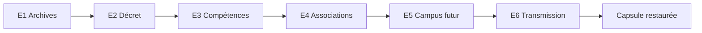

> Archive de conception. Le [README consolidé de référence](../README.md) remplace cette proposition pour les décisions de game design et d’architecture.

# La mémoire de demain

## Intention

Faire découvrir l’ENSIIE en manipulant des traces de son histoire, en reliant ses compétences aux activités de ses élèves et en construisant un futur possible. Chaque énigme doit laisser une connaissance identifiable, en plus d’un code.

Le scénario, les personnages, les numéros des cartes et les données de simulation sont des créations pour le jeu. Les faits institutionnels sont référencés dans la [recherche documentaire](01-recherche-documentaire.md).

## Situation de départ

Nous sommes en **2068**. Une capsule de mémoire doit être ouverte pour les cent ans de l’origine de l’école. Mais ses archives ont perdu leur classement, son portrait du présent est incomplet et son module de transmission refuse de démarrer.

Les joueurs deviennent une équipe de restauration. Ils doivent retrouver les origines, reconnecter les savoirs et la vie étudiante, puis préparer une transmission durable. Six fragments récupérés permettent de réouvrir la capsule.

L’enjeu est la sauvegarde d’une mémoire collective. La réussite déclenche l’ouverture d’une boîte réelle ou d’une capsule à l’écran ; aucune porte du bâtiment ne doit être verrouillée pour les joueurs.

## Public et durée proposés

Équipes de 3 à 5 joueurs, à partir d’environ 15 ans, sans connaissance préalable de l’école ni compétence de programmation requise. Un téléphone par équipe suffit ; tous les éléments existent aussi en papier.

Objectif de durée : **40 à 45 minutes**, comprenant environ 31 minutes d’énigmes et de final, 3 minutes d’introduction, 5 à 8 minutes de déplacements et 2 minutes de conclusion. Ce sont des estimations à mesurer pendant un essai.

## Parcours

| Étape | Époque | Action des joueurs | Découverte | Cible |
|---|---|---|---|---|
| E1 Les archives déclassées | Passé | Reconstituer une chronologie à partir de notices | Origines, anciens élèves, Évry, changement de nom | 4 min |
| E2 Le décret aux trois dates | Passé | Croiser une date de texte, une publication et une règle | Sens du jalon de 2006 | 4 min |
| E3 L’atelier des compétences | Présent | Relier quatre missions à quatre domaines | Complémentarité des formations | 5 min |
| E4 Les balises des associations | Présent | Chercher et observer quatre panneaux | Vie étudiante et activités collectives | 5 min |
| E5 Le campus sous contraintes | Avenir | Choisir un ensemble de projets compatibles | Arbitrages entre service, ressources et accessibilité | 6 min |
| E6 Le protocole de transmission | Avenir | Exécuter ensemble des instructions sur une grille | Rigueur, communication et transmission des savoirs | 5 min |
| Final La capsule restaurée | Synthèse | Ranger les fragments selon leur sens | Relier les trois époques | 2 min |

Le prototype suit un ordre unique. Cela simplifie les transitions et l’animation. Une fois cette version éprouvée, E3 et E4 pourraient devenir deux branches parallèles, mais cette variante nécessiterait de nouveaux essais.

## Implantation physique

Les points suivants sont des **fonctions de jeu**, pas des salles déjà identifiées. Le repérage doit leur associer des lieux effectivement accessibles.

| Point | Emplacement candidat | Mise en scène | Condition de choix |
|---|---|---|---|
| P0 | Salle de départ, éventuellement C33 | Introduction et capsule | Table disponible, retour possible |
| P1 | Espace d’accueil ou couloir autorisé | Dossier d’archives E1–E2 | Un lien avec l’histoire ou la signalétique de l’école si possible |
| P2 | Espace de formation accessible | Atelier E3 | Possibilité de poser quatre cartes et une fiche |
| P3 | Espace de vie étudiante ou zone autorisée proche | Quatre panneaux E4 répartis sur quelques mètres | Déplacement court, supports visibles, circulation dégagée |
| P4 | Espace de travail collectif | Table de projets E5 et deux postes E6 | Échanges à voix normale possibles |
| P0 | Retour au départ | Ouverture de la capsule | Rassemblement de toute l’équipe |

Prévoir au moins **deux déplacements réels** entre des espaces distincts et une recherche visuelle à E4. Pour les rendre signifiants, l’animateur explique à chaque arrivée la fonction réelle du lieu repéré. Le jeu ne doit pas inventer qu’un espace est un laboratoire, un ancien bâtiment ou un local associatif.

Si un lieu devient inaccessible, déplacer les supports et mettre à jour l’indication de destination. Une version entièrement sur table est utile pour la démonstration ou comme adaptation, mais elle réduit la dimension d’exploration demandée par le sujet.

## Rythme et coopération

Distribuer les notices d’E1 entre plusieurs joueurs. À E3, les missions et les fiches de compétences sont tenues par des personnes différentes. À E4, chaque joueur peut relever une balise. E6 partage explicitement les informations entre une personne qui lit le programme et une autre qui possède la grille.

Les trois chapitres reçoivent des repères écrits et des pictogrammes : dossier pour le passé, atelier pour le présent, graine pour l’avenir. La couleur peut renforcer ces repères, sans être le seul moyen de les reconnaître.

Après chaque réussite, afficher un retour de deux phrases : ce que l’équipe a fait et ce qu’elle vient d’apprendre sur l’école. Le fragment gagné apparaît dans un carnet commun et reste disponible.

## Aide et échec

Trois indices graduels sont disponibles par énigme : orienter l’attention, préciser le mécanisme, puis fournir presque toute la démarche. Une erreur ne retire pas la progression acquise. Le chronomètre mesure une durée ; il ne rend pas le jeu injouable une fois écoulé.

Après environ deux minutes de blocage, l’animateur propose le premier indice. Après le troisième, il peut accompagner la résolution et marquer l’étape « résolue avec aide ». Les fragments restent attribués : l’objectif est la découverte.

## Conclusion du jeu

Le final ouvre un message fictif des élèves de 2068 : « Vous avez retrouvé d’où nous venons, compris ce qui nous rassemble et choisi comment transmettre. La mémoire de l’école peut continuer. »

Terminer par trois questions orales, sans score : un fait du passé retenu, une activité actuelle découverte et un choix d’avenir que l’équipe défendrait. Les joueurs peuvent déposer une idée de futur dans la boîte. Cette contribution est libre et ne conditionne pas la victoire.

## Identité visuelle proposée

Un carnet d’enquête contemporain, des fiches d’archives clairement marquées « reconstitution pédagogique », puis une table de simulation sobre pour le futur. Privilégier la lisibilité sur téléphone, des pictogrammes simples et de grandes cartes manipulables.

Les effets de panne et les animations restent brefs. Les documents historiques sont toujours accessibles en texte. Le prototype n’a besoin ni de casque ni de caméra pour porter son scénario.
